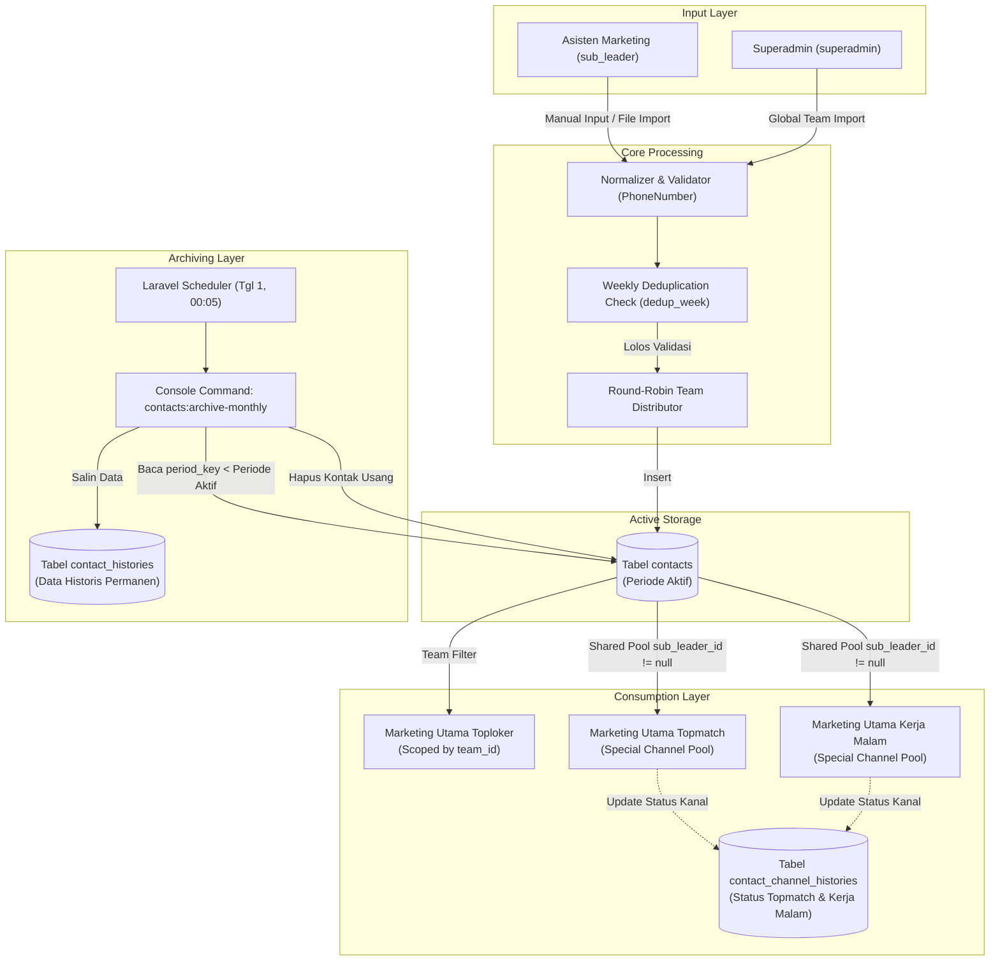
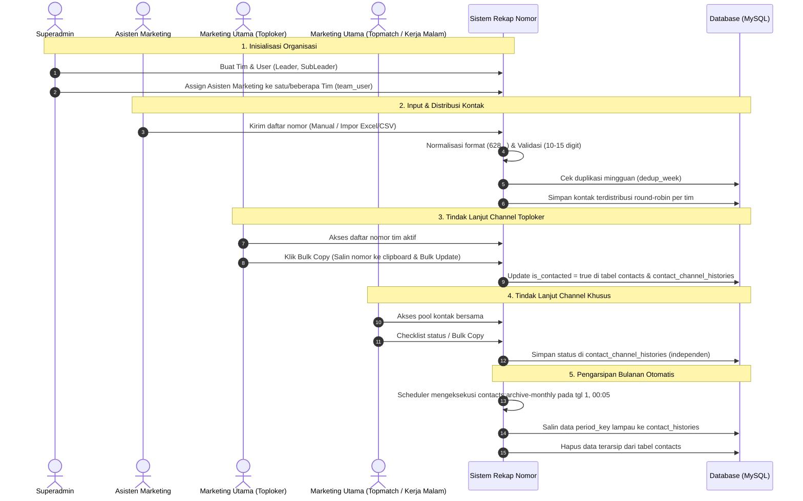
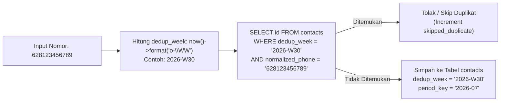
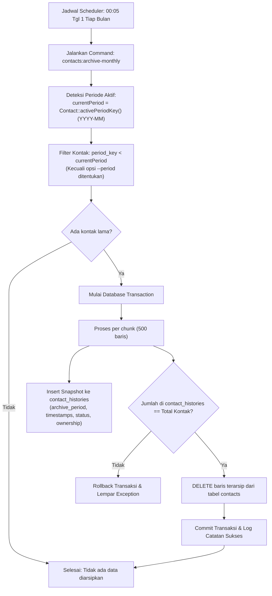

# Rekap Nomor

Aplikasi web internal berbasis Laravel 13 untuk pengumpulan, deduplikasi mingguan, distribusi tim, pemantauan status, dan pengarsipan bulanan nomor kontak tim marketing lintas channel (*Toploker*, *Topmatch*, dan *Kerja Malam*).

---

## Daftar Isi

1. [Ringkasan Proyek](#ringkasan-proyek)
2. [Fitur Utama](#fitur-utama)
3. [Arsitektur Sistem & Multi-Channel](#arsitektur-sistem--multi-channel)
4. [Teknologi yang Digunakan](#teknologi-yang-digunakan)
5. [Role Pengguna & Hak Akses](#role-pengguna--hak-akses)
6. [Alur Bisnis Aplikasi](#alur-bisnis-aplikasi)
7. [Manajemen Kontak & Distribusi](#manajemen-kontak--distribusi)
8. [Sistem Weekly Duplicate Detection](#sistem-weekly-duplicate-detection)
9. [Manajemen Tim & Asisten Multi-Tim](#manajemen-tim--asisten-multi-tim)
10. [Manajemen Status Kontak & WhatsApp](#manajemen-status-kontak--whatsapp)
11. [Sistem Pengarsipan Bulanan (Monthly Archiving)](#sistem-pengarsipan-bulanan-monthly-archiving)
12. [Sistem Permintaan Nomor (Number Request)](#sistem-permintaan-nomor-number-request)
13. [Skema & Struktur Database](#skema--struktur-database)
14. [Struktur Direktori Proyek](#struktur-direktori-proyek)
15. [Kebutuhan Sistem & Prasyarat](#kebutuhan-sistem--prasyarat)
16. [Panduan Instalasi & Setup](#panduan-instalasi--setup)
17. [Konfigurasi Environment](#konfigurasi-environment)
18. [Menjalankan Aplikasi](#menjalankan-aplikasi)
19. [Scheduler & Background Processes](#scheduler--background-processes)
20. [Pengujian Otomatis (Testing)](#pengujian-otomatis-testing)
21. [Pedoman Pengembangan (Development Guidelines)](#pedoman-pengembangan-development-guidelines)

---

## Ringkasan Proyek

**Rekap Nomor** dirancang sebagai pusat operasional terpadu (*single source of truth*) dalam pengelolaan nomor prospek marketing. Sistem ini menangani siklus hidup nomor kontak mulai dari:

- Pengumpulan nomor secara manual maupun impor berkas (`csv`, `txt`, `xlsx`, `xls`).
- Normalisasi nomor telepon standar Indonesia (`628...`).
- Validasi deduplikasi berbasis minggu kalender ISO-8601 (`dedup_week`).
- Distribusi kontak secara bergilir (*round-robin*) ke beberapa tim yang ditangani oleh asisten marketing.
- Aksesibilitas multi-channel marketing: Channel konvensional (*Toploker*) berbasis kepemilikan tim serta channel khusus (*Topmatch* dan *Kerja Malam*) yang memproses pool kontak bersama dengan pencatatan status terisolasi.
- Mekanisme follow-up massal (*bulk copy* ke clipboard dan penandaan status *contacted*).
- Pengarsipan otomatis setiap pergantian bulan ke tabel arsip historis.

---

## Fitur Utama

- **Role-Based Access Control**: Pembagian peran ketat (`superadmin`, `leader`, `sub_leader`) menggunakan middleware `role` (`EnsureRole`).
- **Multi-Channel Marketing Support**:
  - **Toploker**: Struktur hierarki berbasis tim wilayah. Marketing Utama memantau kontak timnya sendiri.
  - **Topmatch & Kerja Malam**: Channel khusus tanpa asisten marketing sendiri. Marketing Utama channel ini mengakses seluruh pool kontak yang diinput asisten marketing dengan pelacakan status kontak independen via `contact_channel_histories`.
- **Multi-Team Assistant**: Asisten marketing dapat diasosiasikan ke banyak tim (`team_user`). Kontak yang diinput/diimpor otomatis didistribusikan secara berimbang (*round-robin*) ke tim-tim terkait.
- **Weekly Duplicate Detection**: Validasi duplikasi nomor telepon berfokus pada minggu kalender ISO (`dedup_week`), memungkinkan nomor yang sama dimasukkan kembali pada minggu yang berbeda meskipun berada di bulan kalender yang sama.
- **Batch Text Input & File Import**:
  - Input teks bebas dengan pemisah spasi, baris baru, koma, atau titik koma.
  - Impor berkas spreadsheet/teks (`.csv`, `.txt`, `.xlsx`, `.xls`) dengan deteksi otomatis header alias nomor dan nama kontak.
- **Follow-up & Bulk Actions**:
  - Toggle status satuan per kontak via antarmuka tabel.
  - Tombol **Bulk Copy**: Sekali klik menyalin seluruh nomor telepon pada halaman aktif ke clipboard sekaligus menandai status kontak menjadi *Sudah Dihubungi* di backend.
  - Endpoint redirect WhatsApp terotorisasi (`/leader/contacts/{contact}/whatsapp`).
- **Number Request System**: Fitur transfer kontak antar Marketing Utama Toploker ketika nomor kontak pada tim asal telah habis ditindaklanjuti.
- **Automated Monthly Archiving**: Command konsol `contacts:archive-monthly` yang terjadwal otomatis setiap tanggal 1 awal bulan pukul 00:05 untuk mengarsipkan kontak lama ke `contact_histories` dan mereset tabel kontak aktif.
- **Modul Histori Lengkap**: Halaman pencarian dan penelusuran data arsip lampau per periode arsip (`archive_period`) untuk semua tingkatan role.
- **Role-Aware Dashboard**: Visualisasi analitik target harian, performa 7 hari terakhir, perbandingan antar tim, leaderboard marketing teraktif, dan rekapitulasi tren 12 bulan (menggabungkan kontak aktif dan arsip).

---

## Arsitektur Sistem & Multi-Channel

Aplikasi menerapkan pemisahan kanal marketing pada entitas pengguna (`users.marketing_channel`):



---

## Teknologi yang Digunakan

| Komponen | Spesifikasi / Paket | Kegunaan |
|---|---|---|
| **Framework Backend** | Laravel 13.0 | Framework aplikasi utama berbasis PHP |
| **Bahasa Pemrograman** | PHP ^8.3 | Runtime backend |
| **Database** | MySQL / MariaDB (SQLite untuk testing) | RDBMS penyimpanan relasional |
| **Frontend Framework** | Blade Templating | Rendering antarmuka server-side |
| **CSS & Styling** | Tailwind CSS | Utility-first CSS styling |
| **Build Tool** | Vite | Asset bundler untuk CSS dan JavaScript |
| **Interaktivitas UI** | Alpine.js & Vanilla JavaScript | State management komponen dan request AJAX |
| **Visualisasi Data** | Chart.js | Rendering diagram statistik pada dashboard dan monitoring |
| **Spreadsheet Engine** | `phpoffice/phpspreadsheet` (^5.7) | Ekstraksi dan parsing berkas Excel (`.xlsx`, `.xls`) dan CSV |
| **Autentikasi** | Laravel Breeze (^2.4) | Scaffolding login, reset password, dan manajemen sesi |
| **Task Runner** | `concurrently` (via npm / composer run dev) | Menjalankan web server, queue listener, dan Vite secara paralel |

---

## Role Pengguna & Hak Akses

Konstanta role didefinisikan pada model `App\Models\User`:
- `User::ROLE_SUPERADMIN` (`superadmin`)
- `User::ROLE_LEADER` (`leader`) — disebut juga **Marketing Utama**
- `User::ROLE_SUB_LEADER` (`sub_leader`) — disebut juga **Asisten Marketing**

### Matriks Hak Akses & Kapabilitas

| Fitur / Halaman | Superadmin | Marketing Utama (Toploker) | Marketing Utama (Topmatch / Kerja Malam) | Asisten Marketing |
|---|:---:|:---:|:---:|:---:|
| **Dashboard Metrik** | Global (Seluruh Sistem & Tim) | Tim Sendiri | Channel Khusus (Pool Bersama) | Nomor Inputan Sendiri |
| **Manajemen Tim & User** | Full Akses (Buat Tim, Buat User, Assign Tim, Hapus) | Tidak Ada | Tidak Ada | Tidak Ada |
| **Input Kontak Manual** | Tidak Ada | Tidak Ada | Tidak Ada | Ya (Multi-nomor / Form) |
| **Impor Berkas Kontak** | Ya (Global per Tim) | Tidak Ada | Tidak Ada | Ya (Terdistribusi ke Timnya) |
| **Lihat Kontak Aktif** | Rekap Seluruh Tim | Kontak Tim Sendiri | Seluruh Kontak dari Asisten | Nomor Inputan Sendiri |
| **Ubah Status Kontak** | Tidak Ada | Ya (Tabel `contacts` & channel history) | Ya (Tabel `contact_channel_histories`) | Tidak Ada |
| **Bulk Copy & Status** | Tidak Ada | Ya | Ya | Tidak Ada |
| **Ekspor CSV Kontak** | Tidak Ada | Ya (Kontak Tim) | Ya (Pool Kontak Bersama) | Tidak Ada |
| **Permintaan Nomor (Request)** | Tidak Ada | Ya (Mengajukan / Menyetujui) | Ditolak (HTTP 403) | Tidak Ada |
| **Akses Data Histori** | Seluruh Histori Sistem | Histori Tim Sendiri | Seluruh Histori dari Asisten | Histori Inputan Sendiri |

### Target Harian Operasional

Setiap role dan channel memiliki target harian yang terintegrasi dengan progress tracker di dashboard:
- **Marketing Utama Toploker**: 300 nomor / hari (`User::TARGET_LEADER`)
- **Marketing Utama Topmatch**: 200 nomor / hari (`User::TARGET_TOPMATCH`)
- **Marketing Utama Kerja Malam**: 200 nomor / hari (`User::TARGET_KERJA_MALAM`)
- **Asisten Marketing**: 150 nomor / hari (`User::TARGET_SUB_LEADER`)

---

## Alur Bisnis Aplikasi



---

## Manajemen Kontak & Distribusi

### 1. Normalisasi dan Validasi Nomor Telepon (`App\Support\PhoneNumber`)

Semua input nomor telepon melewati proses pembersihan ketat:
1. Seluruh karakter non-digit dihilangkan (`preg_replace('/\D+/', '', $raw)`).
2. Jika nomor diawali karakter `0`, angka `0` dipangkas dan diganti prefix internasional Indonesia `62`.
3. Nomor wajib diawali dengan prefix `62`.
4. Panjang karakter nomor normal wajib berada pada rentang **10 hingga 15 digit**.
5. Nilai yang disimpan pada basis data berupa string angka murni (contoh: `628123456789`).

### 2. Aturan Format Berkas Impor (`App\Services\ContactImportService`)

- **Batas Ukuran**: Maksimal 5 MB (`5120 KB`).
- **Format yang Diterima**: `.csv`, `.txt`, `.xlsx`, `.xls`.
- **Deteksi Header Kolom Otomatis**:
  - Kolom Nomor Telepon: `phone`, `nomor`, `no hp`, `nohp`, `number`, `no_telp`, `notelp`, `telepon`.
  - Kolom Nama Kontak (Opsional): `name`, `nama`, `contact_name`, `kontak`, `nama_perusahaan`, `nama perusahaan`.
- Berkas tanpa kolom nomor yang cocok akan memicu penolakan dengan pesan error deskriptif.

---

## Sistem Weekly Duplicate Detection

Sistem mengimplementasikan deteksi duplikasi berbasis **minggu kalender ISO-8601**:



### Mekanisme Kunci

1. **Kolom `dedup_week`**:
   Format string ISO week 8 karakter (`o-\WW`), contoh: `2026-W28`, `2026-W29`.
2. **Database Constraint**:
   Tabel `contacts` memiliki indeks unik komposit:
   ```sql
   UNIQUE KEY `contacts_normalized_phone_dedup_week_unique` (`normalized_phone`, `dedup_week`)
   ```
3. **Cakupan Pemeriksaan Duplikasi**:
   - Pemeriksaan duplikasi bersifat **global lintas tim dan asisten**: jika Tim A telah memasukkan nomor `628123...` di minggu `2026-W30`, Tim B tidak dapat memasukkan nomor tersebut pada minggu `2026-W30`.
   - Pemeriksaan duplikasi **tidak berlaku seumur hidup**: jika nomor `628123...` pernah dimasukkan pada minggu `2026-W29`, nomor tersebut **diizinkan** masuk kembali pada minggu `2026-W30` (meskipun masih dalam bulan kalender yang sama).
4. **Perbedaan `dedup_week` vs `period_key`**:
   - `dedup_week` (`YYYY-\WWW`): Khusus untuk aturan deduplikasi mingguan.
   - `period_key` (`YYYY-MM`): Mengikuti bulan kalender untuk agregasi laporan, filter bulan berjalan, dan trigger pengarsipan bulanan.

---

## Manajemen Tim & Asisten Multi-Tim

Untuk mendukung kebutuhan fleksibilitas operasional asisten marketing yang mengelola lebih dari satu tim wilayah:

1. **Relasi Many-to-Many (`team_user`)**:
   - Tabel pivot `team_user` menghubungkan `user_id` (role `sub_leader`) dengan `team_id`.
   - Superadmin dapat memilih beberapa tim sekaligus saat membuat atau memperbarui akun asisten marketing.
2. **Algoritma Distribusi Round-Robin**:
   Saat asisten marketing memasukkan kumpulan nomor (baik input teks massal maupun impor berkas), sistem mendistribusikan kontak ke tim-tim yang ditugaskan secara bergiliran:
   $$\text{Team ID} = \text{TeamIDs}[\text{index} \pmod{\text{totalTeams}}]$$
3. **Umpan Balik Transparan**:
   Sistem menampilkan rincian hasil distribusi pada flash message session (contoh: `Input selesai. Total: 10, Berhasil: 10 | Distribusi: Tim Barat: 5, Tim Timur: 5`).

---

## Manajemen Status Kontak & WhatsApp

### 1. Definisi Status
- `Contact::STATUS_UNCONTACTED` (`'belum_dihubungi'`): Status default setiap kontak baru.
- `Contact::STATUS_CONTACTED` (`'sudah_dihubungi'`): Kontak telah ditindaklanjuti.
- Kolom boolean `contacts.is_contacted` sinkron dengan status kontak.

### 2. Perilaku Perubahan Status

#### A. Single Status Update (AJAX Checkbox)
Marketing Utama dapat mencentang checkbox pada tabel kontak:
- **Endpoint**: `PATCH /leader/contacts/{contact}/status`
- **Payload**: `{"is_contacted": true|false}`
- **Hasil**:
  - Untuk Toploker: Mengupdate `contacts.is_contacted`, `status`, `status_updated_by`, `status_updated_at`, dan mencatat ke `contact_channel_histories`.
  - Untuk Topmatch & Kerja Malam: Menyimpan status khusus channel pada tabel `contact_channel_histories`.

#### B. Bulk Copy & Auto-Status Update
Pada header kolom nomor tabel kontak Marketing Utama, tersedia tombol **Bulk Copy**:
1. JavaScript membaca seluruh nomor telepon yang tampil pada halaman aktif.
2. Seluruh nomor disalin ke clipboard pengguna (dipisahkan baris baru) untuk kemudahan broadcast/paste ke WhatsApp Web.
3. Secara otomatis mengirim request ke `PATCH /leader/contacts/bulk-status` dengan payload `{"contact_ids": [...]}`.
4. Backend menandai seluruh ID kontak tersebut sebagai `sudah_dihubungi` secara massal.

#### C. Integrasi WhatsApp (`contacts.whatsapp`)
- **Endpoint**: `GET /leader/contacts/{contact}/whatsapp`
- **Aksi Backend**: Memverifikasi hak akses leader terhadap kontak, kemudian me-redirect browser pengguna ke URL WhatsApp resmi:
  `https://wa.me/{whatsapp_phone}`

---

## Sistem Pengarsipan Bulanan (Monthly Archiving)

Untuk menjaga performa query tabel operasional `contacts` agar tetap ringan, sistem menerapkan pengarsipan berkala.

### Alur Kerja Command `contacts:archive-monthly`



### Karakteristik Snapshot Arsip (`contact_histories`)
- Menyimpan salinan lengkap data kontak: `contact_name`, `phone`, `normalized_phone`, `period_key`, `team_id`, `sub_leader_id`, `leader_id`, `input_by`, `status`, `is_contacted`, `status_updated_by`, `status_updated_at`, `contacted_at`, `contacted_by_leader_id`.
- Menyimpan metadata arsip: `archive_period` (format `YYYY-MM`), `archived_at`, dan `original_created_at`.
- Memiliki indeks performa pada kolom `phone`, `normalized_phone`, `archive_period`, `archived_at`, `contact_id`, `team_id`, `leader_id`, dan `sub_leader_id`.

### Menjalankan Command Pengarsipan Manual

```bash
# Menjalankan simulasi tanpa mengubah database
php artisan contacts:archive-monthly --dry-run

# Mengarsipkan semua kontak dari periode sebelum bulan berjalan
php artisan contacts:archive-monthly

# Mengarsipkan kontak untuk periode bulan tertentu secara spesifik
php artisan contacts:archive-monthly --period=2026-06
```

---

## Sistem Permintaan Nomor (Number Request)

Fitur ini diperuntukkan khusus bagi **Marketing Utama Toploker** untuk saling mendistribusikan nomor prospek yang belum dihubungi:

- **Syarat Pengajuan**: Marketing Utama hanya dapat membuat permintaan nomor baru jika seluruh nomor tim miliknya sudah berstatus `is_contacted = true`.
- **Batas Permintaan**: Maksimal sejumlah target harian leader (`User::TARGET_LEADER` = 300 nomor).
- **Proses Persetujuan (`approve`)**:
  1. Sistem memverifikasi ketersediaan nomor belum dihubungi pada penerima request.
  2. Dalam sebuah database transaction, kepemilikan kontak (`leader_id`) dialihkan ke pemohon request.
  3. Status request diubah menjadi `approved` dan aktivitas dicatat pada tabel `number_request_logs`.
- **Akses Channel Khusus**: Dinonaktifkan untuk channel *Topmatch* dan *Kerja Malam* (`HTTP 403`).

---

## Skema & Struktur Database

### 1. Entitas Pengguna & Tim

#### `teams`
| Kolom | Tipe Data | Keterangan |
|---|---|---|
| `id` | `BIGINT UNSIGNED AUTO_INCREMENT` | Primary Key |
| `name` | `VARCHAR(255)` | Nama tim wilayah (unik) |
| `created_at`, `updated_at` | `TIMESTAMP` | Timestamp pembuatan/update |

#### `users`
| Kolom | Tipe Data | Keterangan |
|---|---|---|
| `id` | `BIGINT UNSIGNED AUTO_INCREMENT` | Primary Key |
| `name` | `VARCHAR(255)` | Nama lengkap user |
| `email` | `VARCHAR(255)` | Alamat email (unik) |
| `email_verified_at` | `TIMESTAMP NULL` | Tanggal verifikasi email |
| `password` | `VARCHAR(255)` | Hash password |
| `role` | `VARCHAR(255)` | `superadmin`, `leader`, `sub_leader` |
| `team_id` | `BIGINT UNSIGNED NULL` | FK ke `teams.id` (nullOnDelete) |
| `marketing_channel` | `VARCHAR(255) NULL` | `toploker`, `topmatch`, `kerja_malam` |
| `leader_id` | `BIGINT UNSIGNED NULL` | FK ke `users.id` (nullOnDelete) |
| `remember_token` | `VARCHAR(100) NULL` | Token remember-me |
| `created_at`, `updated_at` | `TIMESTAMP` | Timestamp pembuatan/update |

#### `team_user` (Pivot Asisten Multi-Tim)
| Kolom | Tipe Data | Keterangan |
|---|---|---|
| `id` | `BIGINT UNSIGNED AUTO_INCREMENT` | Primary Key |
| `team_id` | `BIGINT UNSIGNED` | FK ke `teams.id` (cascadeOnDelete) |
| `user_id` | `BIGINT UNSIGNED` | FK ke `users.id` (cascadeOnDelete) |
| `created_at`, `updated_at` | `TIMESTAMP` | Timestamp relasi |

---

### 2. Entitas Kontak & Status Channel

#### `contacts` (Tabel Operasional Aktif)
| Kolom | Tipe Data | Keterangan |
|---|---|---|
| `id` | `BIGINT UNSIGNED AUTO_INCREMENT` | Primary Key |
| `contact_name` | `VARCHAR(255) NULL` | Nama prospek/kontak |
| `phone` | `VARCHAR(255)` | Nomor telepon input |
| `normalized_phone` | `VARCHAR(20) NULL` | Nomor format 628... |
| `period_key` | `VARCHAR(7) NULL` | Periode bulanan (`YYYY-MM`) |
| `dedup_week` | `VARCHAR(8) NULL` | Kunci ISO week (`YYYY-\WWW`) |
| `team_id` | `BIGINT UNSIGNED NULL` | FK ke `teams.id` (nullOnDelete) |
| `sub_leader_id` | `BIGINT UNSIGNED NULL` | FK ke `users.id` (nullOnDelete) |
| `input_by` | `BIGINT UNSIGNED NULL` | FK ke `users.id` pencatat kontak |
| `leader_id` | `BIGINT UNSIGNED NULL` | FK ke `users.id` leader penanggung jawab |
| `status` | `VARCHAR(32)` | `'belum_dihubungi'`, `'sudah_dihubungi'` |
| `is_contacted` | `TINYINT(1)` | Flag status dihubungi (default `0`) |
| `status_updated_by` | `BIGINT UNSIGNED NULL` | FK ke `users.id` pengubah status |
| `status_updated_at` | `TIMESTAMP NULL` | Timestamp pembaruan status |
| `contacted_at` | `TIMESTAMP NULL` | Timestamp pertama kali dihubungi |
| `contacted_by_leader_id` | `BIGINT UNSIGNED NULL` | FK ke `users.id` leader yang menghubungi |
| `created_at`, `updated_at` | `TIMESTAMP` | Timestamp pembuatan/update |

*Indeks Unik Aktif*: `UNIQUE KEY (normalized_phone, dedup_week)`.

#### `contact_channel_histories` (Status Independen Channel Khusus)
| Kolom | Tipe Data | Keterangan |
|---|---|---|
| `id` | `BIGINT UNSIGNED AUTO_INCREMENT` | Primary Key |
| `contact_id` | `BIGINT UNSIGNED` | FK ke `contacts.id` (cascadeOnDelete) |
| `marketing_channel` | `VARCHAR(255)` | `toploker`, `topmatch`, `kerja_malam` |
| `marketing_user_id` | `BIGINT UNSIGNED` | FK ke `users.id` pengguna yang memproses |
| `is_contacted` | `TINYINT(1)` | Status kontak pada kanal tersebut |
| `contacted_at` | `TIMESTAMP NULL` | Waktu dihubungi |
| `status_updated_by` | `BIGINT UNSIGNED NULL` | FK ke `users.id` pengubah status |
| `status_updated_at` | `TIMESTAMP NULL` | Waktu update status kanal |
| `created_at`, `updated_at` | `TIMESTAMP` | Timestamp pembuatan/update |

*Indeks Unik*: `UNIQUE KEY (contact_id, marketing_channel)`.

#### `contact_histories` (Tabel Arsip Historis)
Menyimpan salinan snapshot baris dari tabel `contacts` yang telah diarsipkan, ditambah metadata:
- `contact_id` (`BIGINT UNSIGNED NULL`): ID kontak asli sebelum dihapus.
- `archive_period` (`VARCHAR(7)`): Periode bulan arsip (`YYYY-MM`).
- `archived_at` (`TIMESTAMP`): Waktu eksekusi pengarsipan.
- `original_created_at` (`TIMESTAMP NULL`): Timestamp asli saat kontak pertama kali diinput.

---

### 3. Entitas Number Requests

#### `number_requests`
| Kolom | Tipe Data | Keterangan |
|---|---|---|
| `id` | `BIGINT UNSIGNED AUTO_INCREMENT` | Primary Key |
| `requester_id` | `BIGINT UNSIGNED` | FK ke `users.id` pemohon |
| `recipient_id` | `BIGINT UNSIGNED` | FK ke `users.id` penerima permohonan |
| `amount` | `INT UNSIGNED` | Jumlah nomor yang diminta |
| `message` | `TEXT NULL` | Catatan/alasan pengajuan |
| `status` | `VARCHAR(255)` | `'pending'`, `'approved'`, `'rejected'` |
| `response_message` | `TEXT NULL` | Pesan balasan persetujuan/penolakan |
| `responded_at` | `TIMESTAMP NULL` | Waktu tanggapan diberikan |
| `created_at`, `updated_at` | `TIMESTAMP` | Timestamp permohonan |

#### `number_request_logs`
| Kolom | Tipe Data | Keterangan |
|---|---|---|
| `id` | `BIGINT UNSIGNED AUTO_INCREMENT` | Primary Key |
| `number_request_id` | `BIGINT UNSIGNED` | FK ke `number_requests.id` (cascade) |
| `actor_id` | `BIGINT UNSIGNED` | FK ke `users.id` pelaku aksi |
| `status` | `VARCHAR(255)` | Status saat log dicatat |
| `note` | `TEXT NULL` | Deskripsi tindakan log |
| `created_at` | `TIMESTAMP` | Waktu pencatatan log |

---

## Struktur Direktori Proyek

```
rekap_nomor/
├── app/
│   ├── Console/Commands/
│   │   └── ArchiveMonthlyContacts.php      # Command arsip bulanan (contacts:archive-monthly)
│   ├── Http/
│   │   ├── Controllers/
│   │   │   ├── Auth/                       # Controller autentikasi Breeze
│   │   │   ├── DashboardController.php     # Controller agregasi dashboard utama
│   │   │   ├── ProfileController.php       # Controller manajemen profil akun
│   │   │   ├── SuperAdmin/
│   │   │   │   ├── ContactController.php   # Rekap kontak global & filter per leader
│   │   │   │   ├── ContactHistoryController.php # Penelusuran arsip kontak global
│   │   │   │   └── UserManagementController.php # Kelola user, tim, dan import global
│   │   │   ├── Leader/
│   │   │   │   ├── ContactController.php   # Rekap kontak, export, update status, WhatsApp
│   │   │   │   ├── ContactHistoryController.php # Penelusuran arsip kontak tim
│   │   │   │   └── NumberRequestController.php  # Pengajuan & approval transfer nomor
│   │   │   └── SubLeader/
│   │   │       ├── ContactController.php   # Form input manual, import, dan distribusi
│   │   │       └── ContactHistoryController.php # Riwayat input mandiri yang terarsip
│   │   └── Middleware/
│   │       └── EnsureRole.php              # Middleware proteksi role ('role:...')
│   ├── Models/
│   │   ├── Contact.php                     # Model kontak operasional aktif
│   │   ├── ContactChannelHistory.php      # Model status kontak per marketing channel
│   │   ├── ContactHistory.php              # Model data arsip kontak historis
│   │   ├── NumberRequest.php               # Model pengajuan nomor
│   │   ├── NumberRequestLog.php            # Model log riwayat pengajuan nomor
│   │   ├── Team.php                        # Model tim wilayah
│   │   └── User.php                        # Model pengguna dan hierarki peran
│   ├── Services/
│   │   ├── ContactFilter.php               # Handler parameter pencarian & filter tanggal
│   │   ├── ContactImportService.php        # Service ekstraksi file dan impor baris
│   │   ├── DashboardRecapService.php       # Service builder metrik statistik dashboard
│   │   └── LeaderSummaryService.php        # Service agregasi ringkasan performa leader
│   └── Support/
│       └── PhoneNumber.php                 # Helper normalisasi & validasi nomor telepon
├── database/
│   ├── migrations/                         # Migration database skema dan revisi
│   └── seeders/
│       ├── DatabaseSeeder.php              # Seeder utama pemanggil hierarki
│       ├── RoleHierarchySeeder.php         # Seeder struktur role dan contoh kontak
│       └── SuperAdminSeeder.php            # Seeder akun awal superadmin
├── resources/
│   ├── css/                                # Tailwind stylesheets
│   ├── js/                                 # Entrypoint JavaScript aplikasi
│   └── views/
│       ├── dashboard.blade.php             # Tampilan dashboard dinamis per role
│       ├── layouts/                        # Master layout (app, guest, navigation)
│       ├── leader/                         # Tampilan untuk Marketing Utama
│       ├── subleader/                      # Tampilan untuk Asisten Marketing
│       └── superadmin/                     # Tampilan untuk Superadmin
├── routes/
│   ├── auth.php                            # Rute otentikasi Breeze
│   ├── console.php                         # Definisi scheduler pengarsipan bulanan
│   └── web.php                             # Rute utama aplikasi
└── tests/
    ├── Feature/                            # Feature tests (Auth, Leader, SubLeader, SuperAdmin)
    └── Unit/                               # Unit tests (PhoneNumberTest, etc.)
```

---

## Kebutuhan Sistem & Prasyarat

Pastikan environment Anda memenuhi persyaratan berikut sebelum instalasi:

- **PHP**: Versi `^8.3` dengan ekstensi: `pdo`, `pdo_mysql`, `mbstring`, `openssl`, `zip`, `gd` / `imagick` (untuk spreadsheet).
- **Composer**: Versi `2.x`.
- **Node.js**: Versi `18.x` atau `20.x LTS` & **npm**.
- **Database Server**: MySQL `8.0+` atau MariaDB `10.4+`.

---

## Panduan Instalasi & Setup

### 1. Clone Repository
```bash
git clone https://github.com/findmeornot/rekap_nomor.git
cd rekap_nomor
```

### 2. Instal Dependensi Backend & Frontend
```bash
composer install
npm install
```

### 3. Konfigurasi Environment File
Salin template `.env.example` ke file `.env` baru:
```bash
cp .env.example .env
php artisan key:generate
```

---

## Konfigurasi Environment

Sesuaikan parameter koneksi basis data pada file `.env`:

```env
APP_NAME="Top Number"
APP_ENV=local
APP_KEY=base64:...
APP_DEBUG=true
APP_URL=http://localhost:9001

DB_CONNECTION=mysql
DB_HOST=127.0.0.1
DB_PORT=3306
DB_DATABASE=rekap_nomor
DB_USERNAME=root
DB_PASSWORD=

QUEUE_CONNECTION=database
CACHE_STORE=database
SESSION_DRIVER=file
```

---

## Database Setup

Jalankan migrasi seluruh tabel aplikasi:

```bash
php artisan migrate
```

### Menjalankan Seeder Data Awal (Opsional)

Untuk membuat user default `Super Admin` (`superadmin@example.com` / `password123`) serta struktur hierarki contoh:

```bash
# Menjalankan RoleHierarchySeeder bawaan
php artisan db:seed

# Atau membuat akun Super Admin saja
php artisan db:seed --class=SuperAdminSeeder
```

---

## Menjalankan Aplikasi

Aplikasi telah dilengkapi skrip otomatis `dev` pada `composer.json` yang menjalankan web server pada **port 9001**, background queue listener, dan Vite compiler secara bersamaan:

```bash
composer run dev
```

Perintah di atas akan menjalankan secara paralel:
1. `php artisan serve --host=127.0.0.1 --port=9001 --no-reload`
2. `php artisan queue:listen --tries=1 --timeout=0`
3. `npm run dev`

Buka browser dan akses aplikasi melalui: **`http://localhost:9001`**

---

## Scheduler & Background Processes

Pengarsipan data bulanan terdaftar pada `routes/console.php`:

```php
Schedule::command('contacts:archive-monthly')
    ->monthlyOn(1, '00:05')
    ->withoutOverlapping()
    ->runInBackground()
    ->appendOutputTo(storage_path('logs/archive-monthly.log'));
```

### Konfigurasi Cron Server (Production)

Pada server production, daftarkan Cron Job Linux untuk menjalankan Laravel Scheduler setiap menit:

```cron
* * * * * cd /path/to/rekap_nomor && php artisan schedule:run >> /dev/null 2>&1
```

### Menjalankan Worker Antrean (Queue Worker)

Jika fitur notifikasi atau job asinkron diaktifkan:

```bash
php artisan queue:work --tries=3
```

---

## Pengujian Otomatis (Testing)

Proyek dilengkapi dengan test suite lengkap berbasis PHPUnit dan database in-memory SQLite (`:memory:`):

```bash
# Menjalankan seluruh rangkaian tes
composer test

# Atau menggunakan artisan runner langsung
php artisan test
```

### Cakupan Test Utama
- `tests/Unit/Support/PhoneNumberTest.php`: Validasi normalisasi dan batas panjang digit nomor telepon.
- `tests/Feature/SubLeader/ContactStoreTest.php`: Uji input manual, validasi weekly deduplication, dan batas tim.
- `tests/Feature/SubLeader/ContactImportTest.php`: Uji impor berkas CSV serta deteksi duplikasi mingguan.
- `tests/Feature/SuperAdmin/ContactImportTest.php`: Uji impor global ke tim tertentu oleh superadmin.
- `tests/Feature/Leader/ContactStatusTest.php`: Uji toggle perubahan status kontak oleh leader.

---

## Pedoman Pengembangan (Development Guidelines)

1. **Konsistensi Normalisasi**:
   Setiap jalur penerimaan nomor kontak baru wajib menggunakan `App\Support\PhoneNumber::normalize()` dan `App\Support\PhoneNumber::isValid()`.
2. **Integritas Deduplikasi Mingguan**:
   Pemeriksaan duplikasi wajib menyertakan kolom `dedup_week` (`Contact::activeDedupWeekKey()`). Jangan mengubah skema menjadi unik global pada kolom telepon agar tidak merusak alur input berkala.
3. **Pemisahan Logika Channel**:
   Marketing Utama channel khusus (`topmatch`, `kerja_malam`) tidak memiliki tim fisik. Jangan memaksakan pembatasan `team_id` pada channel khusus ini; selalu gunakan relasi `contact_channel_histories`.
4. **Proteksi Akses Role**:
   Semua route baru wajib dibungkus middleware `role:{role_name}` yang didefinisikan pada `bootstrap/app.php`.
5. **Code Formatting**:
   Jalankan Laravel Pint sebelum melakukan commit perubahan:
   ```bash
   ./vendor/bin/pint
   ```
