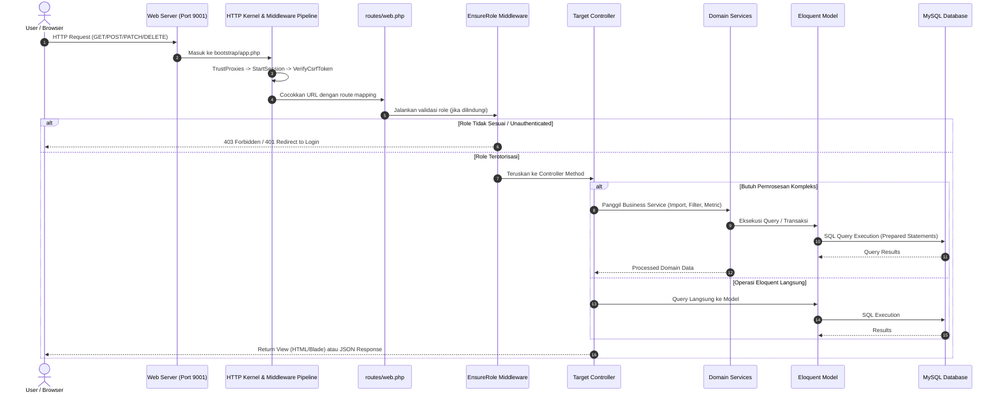
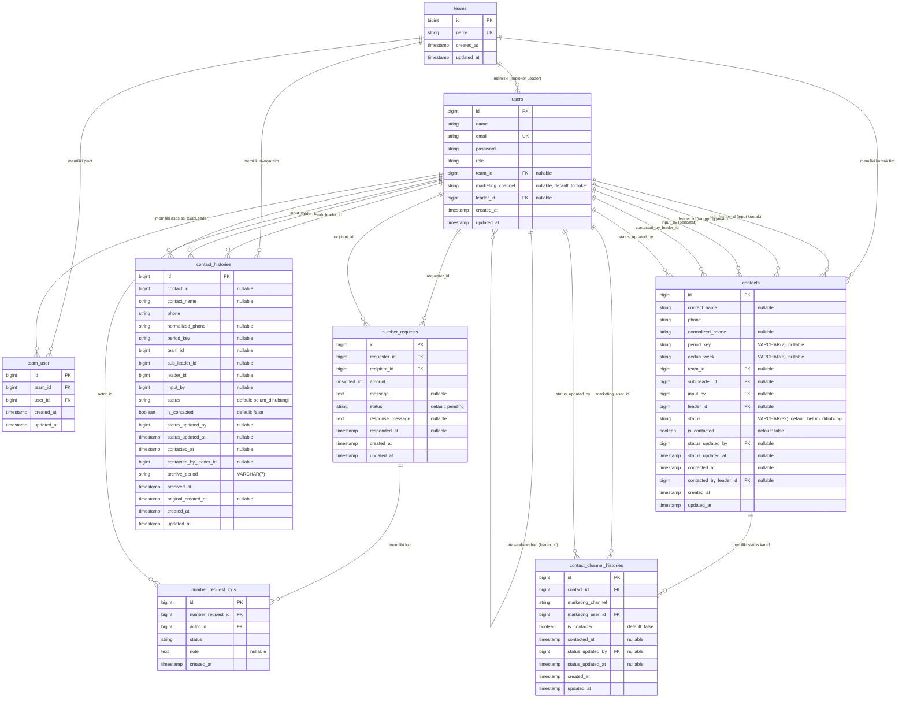
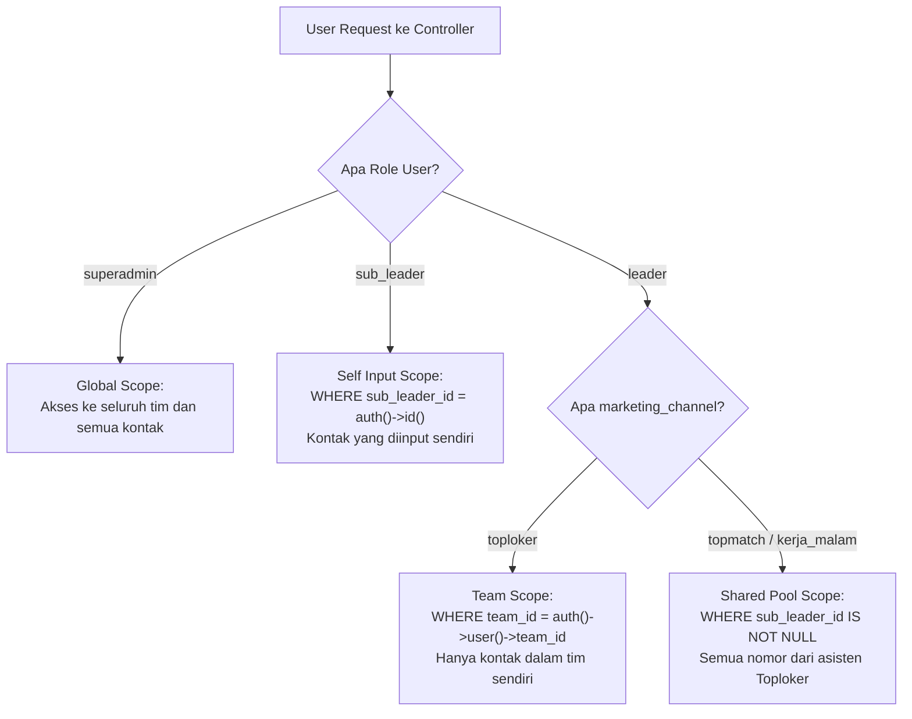
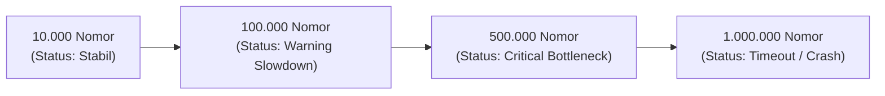
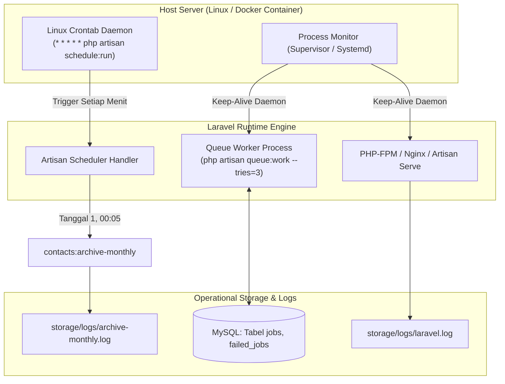
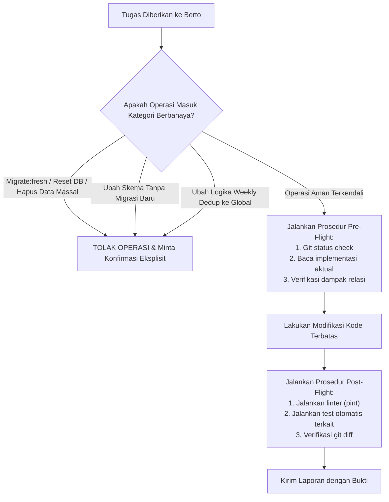

# FULL SYSTEM AUDIT — REKAP NOMOR

Dokumen audit teknis dan fungsional komprehensif sistem Rekap Nomor (*Top Number*). Seluruh informasi dari 15 domain audit disatukan secara lengkap ke dalam dokumen tunggal ini tanpa ada pemotongan informasi.

---

## DAFTAR ISI

1. [Bagian 1 — Ringkasan Eksekutif (Executive Summary)](#bagian-1--ringkasan-eksekutif-executive-summary)
2. [Bagian 2 — Arsitektur Sistem (System Architecture)](#bagian-2--arsitektur-sistem-system-architecture)
3. [Bagian 3 — Logika Bisnis & Alur Kerja (Business Logic & Workflow)](#bagian-3--logika-bisnis--alur-kerja-business-logic--workflow)
4. [Bagian 4 — Analisis Basis Data (Database Analysis & ERD)](#bagian-4--analisis-basis-data-database-analysis--erd)
5. [Bagian 5 — Autentikasi, Otorisasi & Isolasi Data (Authentication & Authorization)](#bagian-5--autentikasi-otorisasi--isolasi-data-authentication--authorization)
6. [Bagian 6 — Audit Keamanan Aplikasi (Application Security Audit)](#bagian-6--audit-keamanan-aplikasi-application-security-audit)
7. [Bagian 7 — Kinerja & Skalabilitas (Performance & Scalability)](#bagian-7--kinerja--skalabilitas-performance--scalability)
8. [Bagian 8 — Audit Antarmuka & Pengalaman Pengguna (Frontend & UX Audit)](#bagian-8--audit-antarmuka--pengalaman-pengguna-frontend--ux-audit)
9. [Bagian 9 — Kualitas Kode & Maintainability (Code Quality Audit)](#bagian-9--kualitas-kode--maintainability-code-quality-audit)
10. [Bagian 10 — Pengujian & Keandalan Sistem (Testing & Reliability)](#bagian-10--pengujian--keandalan-sistem-testing--reliability)
11. [Bagian 11 — Deployment & Operasional Sistem (Deployment & Operations)](#bagian-11--deployment--operasional-sistem-deployment--operations)
12. [Bagian 12 — Register Temuan Audit (Findings Register)](#bagian-12--register-temuan-audit-findings-register)
13. [Bagian 13 — Rencana Tindakan yang Direkomendasikan (Recommended Action Plan)](#bagian-13--rencana-tindakan-yang-direkomendasikan-recommended-action-plan)
14. [Bagian 14 — Basis Pengetahuan Agen AI (System Knowledge Base)](#bagian-14--basis-pengetahuan-agen-ai-system-knowledge-base)
15. [Bagian 15 — Analisis Kebutuhan & Spesifikasi Agen AI Berto (Berto Requirements)](#bagian-15--analisis-kebutuhan--spesifikasi-agen-ai-berto-berto-requirements)

---

## Bagian 1 — Ringkasan Eksekutif (Executive Summary)

## 1. Identitas dan Ruang Lingkup Audit
- **Nama Sistem**: Rekap Nomor (*Top Number*)
- **Target Repository**: `d:\TOPLOKER\rekap_nomor`
- **Branch Aktif**: `feat/assist-tm`
- **Peran Auditor**: Principal Software Architect, Senior Backend Engineer, Application Security Auditor, Database Architect, QA & DevOps Engineer.
- **Tujuan Audit**: Menyajikan evaluasi teknis, fungsional, arsitektural, keamanan, dan skalabilitas secara komprehensif sebagai basis pengetahuan operasional agen AI coding (**Berto**) pada Multica Agent Builder.
- **Sifat Audit**: *Read-Only* (Analisis statis kode sumber, penelusuran relasi basis data, pengujian konfigurasi, dan verifikasi alur logika tanpa mutasi data/skema).

---

## 2. Gambaran Umum Kondisi Sistem

Aplikasi **Rekap Nomor** adalah platform operasional internal berbasis **Laravel 13.0** (PHP 8.3+) yang ditujukan untuk mengelola, merekap, memvalidasi, mendistribusikan, dan memantau penanganan nomor prospek WhatsApp oleh tim marketing.

Sistem mengalami evolusi signifikan dari model monolitik sederhana berbasis hierarki kaku (`sub_leader -> leader -> superadmin`) menjadi arsitektur **multi-channel marketing** (*Toploker*, *Topmatch*, dan *Kerja Malam*) dengan dukungan asisten multi-tim (*Many-to-Many*), deteksi duplikasi mingguan berbasis ISO-8601 week (`dedup_week`), aksi massal (*bulk copy* & *status update*), serta mesin pengarsipan otomatis bulanan (*monthly archiving*).

Secara umum, sistem telah memiliki pondasi alur bisnis yang fungsional dan terfokus pada efisiensi operasional harian. Namun, audit mengidentifikasi sejumlah utang teknis (*technical debt*), inkonsistensi antara kode dan pengujian otomatis, celah kontrol akses (*broken access control* / IDOR), serta potensi bottleneck performa saat volume kontak bertumbuh ke skala ratusan ribu data.

---

## 3. Matriks Hasil Audit per Domain

| Domain Audit | Status Penilaian | Ringkasan Temuan Utama |
|---|:---:|---|
| **Arsitektur Sistem** | **CUKUP (BAIK DENGAN CATATAN)** | Pemisahan layer MVC dan Service (`ContactImportService`, `ContactFilter`, `DashboardRecapService`) cukup baik, namun terjadi *controller bloat* pada `Leader\ContactController` (534 baris) dan tidak adanya *Form Request* pada sebagian besar endpoint modul utama. |
| **Logika Bisnis & Workflow** | **BAIK** | Alur *Weekly Deduplication* (`dedup_week`), distribusi *round-robin* asisten multi-tim, dan isolasi status kanal khusus berjalan konsisten di level service dan database constraint. |
| **Struktur Basis Data** | **CUKUP** | Struktur tabel relasional lengkap dan migrasi historis tercatat rapi. Terdapat inkonsistensi kueri `leader_id` vs `team_id` pada modul transfer nomor, serta beberapa kolom query agregat yang belum memiliki indeks komposit optimal. |
| **Autentikasi & Otorisasi** | **RAWAN (PERLU PERBAIKAN)** | Autentikasi berbasis session Breeze aman. Namun, otorisasi hanya mengandalkan middleware peran (`role:superadmin,leader,sub_leader`) dan kueri manual di controller tanpa *Laravel Policies / Gates*. Terdeteksi celah IDOR pada status update kontak di kanal khusus. |
| **Keamanan Aplikasi** | **SEDANG (MEDIUM RISK)** | Proteksi CSRF, password hashing (Bcrypt), dan prepared statement PDO berjalan baik. Ditemukan celah `ProfileController::destroy` yang memungkinkan penghapusan akun mandiri secara destruktif tanpa proteksi superadmin terakhir atau pencegahan cascade delete log operasional. |
| **Performa & Skalabilitas** | **CUKUP** | Dashboard menggabungkan data aktif dan arsip menggunakan `unionAll` subquery tanpa caching, yang akan mengalami degradasi tajam (*slow query*) ketika data melebihi 100.000 baris. |
| **Frontend & UX** | **BAIK** | Antarmuka responsif menggunakan Tailwind CSS & Alpine.js, alur Bulk Copy sangat efisien bagi pengguna operasional, tetapi terdapat inkonsistensi ketiadaan tombol WhatsApp di UI meskipun rute dan controller menyediakannya. |
| **Kualitas Kode** | **CUKUP** | Terdapat bug pemanggilan konstanta sebagai property (`$subLeader->TARGET_SUB_LEADER`), duplikasi kueri status di berbagai tempat, dan penanganan nullability yang inkonsisten. |
| **Testing & Reliability** | **KRITIS (PERLU PERBAIKAN)** | Test suite memiliki divergensi dengan implementasi aktual: `ContactWhatsappStatusTest` dan `ContactStatusTest` gagal karena ekspektasi payload/efek samping controller telah berubah tanpa memperbarui pengujian. |
| **Deployment & Operasional** | **BAIK** | Konfigurasi `.env` standar Laravel, scheduler terdaftar di `routes/console.php`, dan skrip dev otomatis menggunakan port 9001. |

---

## 4. Temuan Paling Kritis (Top Critical Findings)

1. **[CRIT-01] Inkonsistensi Kueri `NumberRequestController` Mengakibatkan Fitur Transfer Nomor Lumpuh**:
   Pada `NumberRequestController::store` dan `approve`, kueri mencari `Contact::where('leader_id', $user->id)`. Karena seluruh inputan asisten marketing mutakhir disimpan dengan `leader_id = null` dan hanya terikat ke `team_id`, Marketing Utama Toploker tidak dapat memindahkan atau mendistribusikan nomor timnya.
2. **[HIGH-01] Celah Akses dan IDOR pada Bulk Status Kanal Khusus**:
   Pada `Leader\ContactController::bulkUpdateStatus`, validasi kontak kanal khusus (*Topmatch* / *Kerja Malam*) tidak memvalidasi apakah kontak tersebut berasal dari `period_key` aktif dan tidak memvalidasi ownership secara ketat terhadap status kanal lainnya.
3. **[HIGH-02] Potensi Kehilangan Data Destruktif pada `ProfileController::destroy`**:
   Endpoint `DELETE /profile` terbuka bagi semua user. Jika seorang leader menghapus akunnya sendiri, relasi `cascadeOnDelete` pada tabel `number_requests` dan `contact_channel_histories` akan melenyapkan seluruh log audit dan rekam jejak follow-up secara permanen.
4. **[HIGH-03] Test Suite Rusak & Tidak Sinkron dengan Controller**:
   Pengujian fitur leader (`ContactWhatsappStatusTest` dan `ContactStatusTest`) menguji kontrak API lama (mengharapkan payload `{status: 'contacted'}` dan mengharapkan WhatsApp redirect memutasi database), sementara controller telah bermutasi ke payload `{is_contacted: bool}` dan WhatsApp murni redirect.
5. **[MED-01] Bug Property Dinamis `$subLeader->TARGET_SUB_LEADER`**:
   Pada `SubLeader\ContactController::index`, kode memanggil `$subLeader->TARGET_SUB_LEADER` yang bernilai `null` karena didefinisikan sebagai konstanta kelas (`User::TARGET_SUB_LEADER`), menyebabkan kalkulasi progress bar di view asisten selalu bernilai 0.

---

## 5. Kesiapan Sistem untuk AI Agent Berto

Hasil audit ini menyediakan dasar pengetahuan teknis yang definitif bagi **Berto**:
- Telah dipetakan 21 migrasi database dan relasi antar 8 tabel bisnis.
- Telah dirumuskan batasan ketat (*safe boundaries*) agar Berto tidak merusak logika weekly deduplication, tidak memaksakan `team_id` pada kanal khusus, dan tidak memicu cascade delete berbahaya.
- Telah disusun 14 dokumen audit pendukung di direktori `docs/system-audit/` yang siap dijadikan konteks pengetahuan sistemik.


---

## Bagian 2 — Arsitektur Sistem (System Architecture)

## 1. Spesifikasi Teknologi & Stack Inti

- **Framework**: Laravel Framework `13.0.x`
- **Runtime Bahasa**: PHP `^8.3` (menggunakan fitur PHP 8.2/8.3: Readonly properties, Disjunctive Normal Form Types, Attribute syntax, Constructor property promotion).
- **Arsitektur Aplikasi**: Monolith MVC (Model-View-Controller) diperluas dengan Service Layer (`app/Services/`) dan Domain Support (`app/Support/`).
- **Database Utama**: MySQL 8.0+ / MariaDB 10.4+ (Production & Local) | SQLite in-memory (Automated Testing).
- **Frontend Stack**:
  - Blade Templates (`resources/views/`)
  - Tailwind CSS `^3.x`
  - Alpine.js (komponen interaktif UI modal, dropdown, tabs, dan state binding)
  - Chart.js (visualisasi statistik dan metrik performa)
  - Vite (Asset bundler dan hot module replacement)
- **Komponen & Paket Pihak Ketiga Utama**:
  - `phpoffice/phpspreadsheet` (`^5.7`): Pemrosesan file spreadsheet Excel (`.xlsx`, `.xls`) dan CSV.
  - `laravel/breeze` (`^2.4`): Scaffolding autentikasi berbasis session.
  - `fakerphp/faker` & `mockery/mockery`: Prasarana fixture testing.

---

## 2. Diagram Arsitektur Tingkat Tinggi (High-Level Architecture)

```mermaid
graph TD
    Client["Browser / Client Device\n(Desktop & Mobile)"]

    subgraph Presentation_Layer["Presentation Layer (Frontend)"]
        Blade["Blade Views\n(resources/views/*)"]
        Alpine["Alpine.js State Handlers\n(Modal, Toast, Multiselect)"]
        ChartJS["Chart.js Render Engine\n(Dashboard & Tracking)"]
        ViteAssets["Vite Bundled Assets\n(app.css & app.js)"]
    end

    subgraph HTTP_Infrastructure["HTTP Routing & Middleware Layer"]
        Router["Laravel Router (routes/web.php)"]
        AuthMid["auth Middleware"]
        RoleMid["EnsureRole Middleware\n('role:superadmin|leader|sub_leader')"]
    end

    subgraph Application_Layer["Application & Controller Layer"]
        SA_Ctrl["SuperAdmin Controllers\n(User, Contact, History)"]
        L_Ctrl["Leader Controllers\n(Contact, History, Request)"]
        SL_Ctrl["SubLeader Controllers\n(Contact, History)"]
        Dash_Ctrl["DashboardController\n(__invoke)"]
    end

    subgraph Domain_Service_Layer["Domain Service Layer"]
        ImportSvc["ContactImportService\n(Extract & Normalize Rows)"]
        FilterSvc["ContactFilter\n(Date & UI Scope Resolver)"]
        DashSvc["DashboardRecapService\n(Union Query & Metric Builder)"]
        LeadSumSvc["LeaderSummaryService\n(Populate Contacted Summaries)"]
        PhoneSupp["PhoneNumber Support\n(Normalize 628... & Length Check)"]
    end

    subgraph Persistence_Layer["Persistence Layer (Eloquent ORM & DB)"]
        Models["Eloquent Models\n(User, Team, Contact, ContactHistory, etc.)"]
        DB_Live[("MySQL: Tabel Operasional\ncontacts, users, teams, team_user, etc.")]
        DB_Hist[("MySQL: Tabel Historis & Audit\ncontact_histories, contact_channel_histories")]
    end

    subgraph Background_Workers["Background & Asynchronous Layer"]
        Cron["System Cron Daemon\n(* * * * * php artisan schedule:run)"]
        Scheduler["Laravel Scheduler (routes/console.php)"]
        ArchiveCmd["ArchiveMonthlyContacts Command\n(contacts:archive-monthly)"]
        QueueWorker["Queue Worker\n(php artisan queue:listen)"]
    end

    Client <-->|HTTPS / HTTP Requests| Router
    Router --> AuthMid --> RoleMid
    RoleMid --> SA_Ctrl & L_Ctrl & SL_Ctrl & Dash_Ctrl

    SA_Ctrl --> ImportSvc & LeadSumSvc & Models
    L_Ctrl --> FilterSvc & Models
    SL_Ctrl --> ImportSvc & PhoneSupp & Models
    Dash_Ctrl --> DashSvc --> Models

    ImportSvc --> PhoneSupp
    Models <--> DB_Live & DB_Hist

    Cron --> Scheduler --> ArchiveCmd
    ArchiveCmd --> Models
    QueueWorker -.->|Async Jobs (jika aktif)| Models
```

---

## 3. Siklus Hidup Permintaan (Request Lifecycle)



---

## 4. Hubungan Antarmodul dan Pemisahan Tanggung Jawab

Aplikasi membagi tanggung jawab ke dalam 4 modul fungsional utama:

### A. Modul SuperAdmin (`App\Http\Controllers\SuperAdmin\*`)
- **Tanggung Jawab**: Manajemen infrastruktur organisasi dan monitoring global.
- **Komponen**:
  - `UserManagementController`: Pembuatan tim (`storeTeam`), registrasi akun leader multi-channel (`storeLeader`), registrasi asisten marketing (`storeSubLeader`), penugasan tim (`assignTeam`), impor nomor global (`import`), dan penghapusan pengguna (`destroy`).
  - `ContactController`: Visualisasi rekapitulasi kontak aktif seluruh sistem, pemfilteran dinamis per Marketing Utama via `LeaderSummaryService` dan `ContactFilter`.
  - `ContactHistoryController`: Penelusuran arsip kontak lampau seluruh sistem dengan filter periode (`archive_period`), leader, dan sub-leader.

### B. Modul Leader / Marketing Utama (`App\Http\Controllers\Leader\*`)
- **Tanggung Jawab**: Eksekusi follow-up kontak, tracking kinerja harian, dan transfer nomor.
- **Komponen**:
  - `ContactController`: Daftar kontak aktif terisolasi (Toploker berbasis tim, Topmatch/Kerja Malam berbasis pool bersama), export CSV via `Symfony\Component\HttpFoundation\StreamedResponse`, update status individual (`updateStatus`), bulk update status (`bulkUpdateStatus`), dan redirect WhatsApp (`whatsapp`).
  - `ContactHistoryController`: Akses terhadap data historis terarsip yang pernah berada di bawah tanggung jawab tim atau inputan asistennya.
  - `NumberRequestController`: Pengajuan permintaan nomor antar leader Toploker (`store`), persetujuan transfer kontak (`approve`), penolakan (`reject`), dan audit log permohonan.

### C. Modul SubLeader / Asisten Marketing (`App\Http\Controllers\SubLeader\*`)
- **Tanggung Jawab**: Ingesti nomor kontak prospek ke dalam basis data.
- **Komponen**:
  - `ContactController`: Form input teks multi-baris (`store`), impor berkas Excel/CSV (`import`), kalkulasi progress target harian, dan eksekusi algoritma pembagian round-robin tim.
  - `ContactHistoryController`: Penelusuran arsip nomor yang pernah diinput secara mandiri oleh akun yang bersangkutan.

### D. Modul Analytics & Dashboard (`App\Http\Controllers\DashboardController`)
- **Tanggung Jawab**: Agregasi data analitik dinamis sesuai role pengguna.
- **Komponen**:
  - `DashboardController`: Single-action controller (`__invoke`) yang mengarahkan user ke view `dashboard` menggunakan data dari `DashboardRecapService`.
  - `DashboardRecapService`: Penggabungan data tabel aktif `contacts` dan arsip `contact_histories` via `unionAll` untuk menyajikan metrik lifetime, perbandingan harian 7 hari, dan ringkasan bulanan.

---

## 5. Diagram Aliran Data Utama (Main Data Flows)

```mermaid
flowchart LR
    subgraph Ingest["1. Data Ingestion Flow"]
        Input["Raw Text / File"] --> Extract["ContactImportService::extractRows()"]
        Extract --> Clean["PhoneNumber::normalize()"]
        Clean --> Val["PhoneNumber::isValid()"]
        Val --> DedupCheck{"Cek dedup_week\npada Tabel contacts"}
        DedupCheck -- Duplikat --> IncDup["Skip & Counter"]
        DedupCheck -- Unik --> RRDist["Round-Robin Team Split\n(team_user)"]
        RRDist --> SaveC["DB::table('contacts')->insert()"]
    end

    subgraph FollowUp["2. Follow-up & Status Flow"]
        SaveC --> ReadC["Leader Contact Index"]
        ReadC --> Action{"Aksi Leader"}
        Action -- Single Checkbox --> PatchSingle["PATCH /status\n(is_contacted=bool)"]
        Action -- Bulk Copy --> PatchBulk["PATCH /bulk-status\n(contact_ids=[...])"]
        PatchSingle & PatchBulk --> ChannelBranch{"Kanal Pengguna?"}
        ChannelBranch -- Toploker --> UpdLive["Update contacts & contact_channel_histories"]
        ChannelBranch -- Topmatch / KM --> UpdChan["Update contact_channel_histories SAJA"]
    end

    subgraph Archive["3. Archiving Flow"]
        UpdLive & UpdChan --> LiveStorage[("Tabel contacts")]
        LiveStorage --> CronTrigger["Command: contacts:archive-monthly\n(Tgl 1, 00:05)"]
        CronTrigger --> CheckAge{"period_key < currentPeriod?"}
        CheckAge -- Ya --> ChunkInsert["Chunk 500 rows -> Insert contact_histories"]
        ChunkInsert --> VerifyCount{"Jumlah Tepat?"}
        VerifyCount -- Ya --> DeleteOld["DELETE FROM contacts WHERE period_key < current"]
    end
```



---

## 6. Integrasi Background Processes & Scheduler

1. **Definisi Scheduler (`routes/console.php`)**:
   ```php
   Schedule::command('contacts:archive-monthly')
       ->monthlyOn(1, '00:05')
       ->withoutOverlapping()
       ->runInBackground()
       ->appendOutputTo(storage_path('logs/archive-monthly.log'));
   ```
   - **Frekuensi**: Sekali sebulan, tanggal 1 pukul 00:05.
   - **Proteksi**: `withoutOverlapping()` mencegah eksekusi ganda jika batch data besar membutuhkan durasi panjang.
   - **Logging**: Seluruh output proses dicatat secara persisten ke `storage/logs/archive-monthly.log`.
2. **Queue Processing**:
   - Dikonfigurasikan pada `.env` (`QUEUE_CONNECTION=database`).
   - Tabel migrasi antrean tersedia: `jobs`, `job_batches`, `failed_jobs`.
   - Menjalankan listener lokal melalui skrip dev: `php artisan queue:listen --tries=1 --timeout=0`.

---

## 7. Evaluasi Batas Layer & Prinsip Pemisahan (Separation of Concerns)

- **Kelebihan**:
  - Logika sanitasi nomor telepon sepenuhnya diisolasi di [app/Support/PhoneNumber.php](file:///d:/TOPLOKER/rekap_nomor/app/Support/PhoneNumber.php).
  - Parsing file Excel/CSV diisolasi di [app/Services/ContactImportService.php](file:///d:/TOPLOKER/rekap_nomor/app/Services/ContactImportService.php).
  - Filter tanggal dan query parameter diisolasi di [app/Services/ContactFilter.php](file:///d:/TOPLOKER/rekap_nomor/app/Services/ContactFilter.php).
- **Kelemahan & Pelanggaran Arsitektur**:
  - `app/Http/Controllers/Leader/ContactController.php` memuat 534 baris kode yang mencakup formatting tanggal, pemetaan kanal, kalkulasi metrik chart bulanan, dan query builder mentah. Logika ini seharusnya didelegasikan ke Dedicated Service atau Query Scope.
  - Mayoritas controller tidak menggunakan *Form Request* kelas terpisah (seperti `ContactStoreRequest` atau `BulkStatusUpdateRequest`), melainkan melakukan `$request->validate()` langsung di dalam controller.
  - Tidak ada abstraksi *Repository Pattern* atau *Action Classes*; controller berinteraksi langsung dengan model Eloquent atau `DB::table()`.


---

## Bagian 3 — Logika Bisnis & Alur Kerja (Business Logic & Workflow)

## 1. Pemetaan Fitur Sistem Secara Komprehensif

---

### FITUR 1: Ingesti Kontak Teks Manual (Manual Batch Contact Input)

- **Tujuan**: Memungkinkan asisten marketing memasukkan satu atau banyak nomor prospek sekaligus dari format teks bebas (copy-paste dari WhatsApp, dokumen, atau formulir).
- **Aktor**: `sub_leader` (Asisten Marketing).
- **Entry Point**: `POST /sub-leader/contacts` -> `App\Http\Controllers\SubLeader\ContactController::store`.
- **Model & Tabel Terlibat**:
  - `App\Models\Contact` -> tabel `contacts`
  - `App\Models\User` -> tabel `users`
  - `App\Models\Team` -> tabel `teams`, `team_user`
- **Validasi**:
  - Field: `'contact_name' => ['nullable', 'string', 'max:255']`, `'phones' => ['nullable', 'string', 'max:10000']`, `'phone' => ['nullable', 'string', 'max:255']`.
  - Ekstraksi Token: `preg_split('/[\s,;]+/', trim($value))` memecah inputan berdasarkan spasi, koma, titik koma, dan newline.
  - Sanitasi per token: `PhoneNumber::isValid()` dan `PhoneNumber::normalize()`.
  - Validasi Keanggotaan Tim: User wajib memiliki minimal satu tim di tabel `team_user`. Jika tidak, request ditolak kembali dengan error session `phones`.
- **Authorization**: Dilindungi middleware `['auth', 'role:sub_leader']`.
- **Proses Backend**:
  1. Ambil seluruh `team_ids` dari relasi `$subLeader->teams()->pluck('teams.id')`.
  2. Hitung kunci minggu aktif: `dedupWeekKey = Contact::activeDedupWeekKey()` (`o-\WW`).
  3. Kueri nomor eksis pada minggu tersebut: `Contact::where('dedup_week', $dedupWeekKey)->whereIn('normalized_phone', $phones)`.
  4. Lakukan looping nomor unik yang lolos:
     - Gunakan pembagian modulo: `$currentTeamId = $teamIds[$teamIndex % $totalTeams]`.
     - Buat baris baru di tabel `contacts`:
       - `contact_name`: Nama kontak atau null.
       - `phone` & `normalized_phone`: Nomor normal format `628...`.
       - `period_key`: `Contact::activePeriodKey()` (`YYYY-MM`).
       - `dedup_week`: `$dedupWeekKey` (`YYYY-\WWW`).
       - `team_id`: `$currentTeamId`.
       - `sub_leader_id`: `$subLeader->id`.
       - `input_by`: `$subLeader->id`.
       - `leader_id`: `null`.
       - `status`: `'belum_dihubungi'`.
       - `is_contacted`: `false`.
- **Perubahan Data**: Menambah `N` baris pada tabel `contacts`.
- **Output**: Redirect back dengan flash message: `"Input selesai. Total: X, Berhasil: Y, Duplikat: Z, Tidak valid: W | Distribusi: Tim A: n1, Tim B: n2"`.
- **Kondisi Khusus & Potensi Kegagalan**:
  - Jika asisten memasukkan nama kontak bersama dengan 50 nomor telepon, seluruh 50 nomor tersebut akan memiliki `contact_name` yang identik.
  - Race condition: Jika dua asisten menginput nomor yang sama pada detik yang sama di minggu yang sama, salah satu request akan memicu `QueryException (Duplicate entry for key 'contacts_normalized_phone_dedup_week_unique')` karena tidak dibungkus `try-catch` database level pada controller ini.

---

### FITUR 2: Impor Kontak dari Berkas Spreadsheet (Bulk File Import)

- **Tujuan**: Memproses impor massal ribuan nomor prospek dari file Excel atau CSV ke dalam database operasional.
- **Aktor**:
  1. `sub_leader` (via `POST /sub-leader/contacts/import`).
  2. `superadmin` (via `POST /superadmin/import`).
- **Entry Point**:
  - `SubLeader\ContactController::import`
  - `SuperAdmin\UserManagementController::import`
  - Service: `App\Services\ContactImportService`
- **Model & Tabel Terlibat**: `Contact`, `User`, `Team`, `team_user`.
- **Validasi Berkas**:
  - Ekstensi yang diizinkan: `csv`, `txt`, `xlsx`, `xls`.
  - Ukuran maksimal: 5 MB (`max:5120`).
  - Ekstraksi Header: Kolom nomor wajib ada (alias: `phone`, `nomor`, `no hp`, `nohp`, `number`, `no_telp`, `notelp`, `telepon`). Kolom nama bersifat opsional (alias: `name`, `nama`, `contact_name`, `kontak`, `nama_perusahaan`, `nama perusahaan`).
- **Proses Backend**:
  1. `ContactImportService::extractRows($file)` mendeteksi tipe file via ekstensi dan membaca seluruh baris menggunakan `fgetcsv` (CSV/TXT) atau `IOFactory::load` (PhpSpreadsheet untuk Excel).
  2. Header dinormalisasi ke huruf kecil tanpa spasi berlebih. Baris di bawah header dipetakan ke array asosiatif `['contact_name', 'phone']`.
  3. `importRows($rows, $context)`:
     - Kueri seluruh nomor pada minggu aktif (`dedup_week`) menggunakan `pluck('normalized_phone')->flip()` untuk lookup instan `O(1)`.
     - Validasi setiap baris dengan `PhoneNumber::isValid()` dan `PhoneNumber::normalize()`.
     - Deteksi duplikasi terhadap database dan duplikasi intra-file (`$batchPhones`).
     - Alokasi tim:
       - Jika dieksekusi oleh SubLeader: terdistribusi round-robin ke `$context['team_ids']`.
       - Jika dieksekusi oleh SuperAdmin: seluruh nomor dimasukkan ke satu `$context['team_id']` yang dipilih.
     - Simpan kontak ke tabel `contacts`.
- **Output**: Redirect back dengan ringkasan jumlah: berhasil dibuat, dilewati duplikat, dilewati tidak valid, dan distribusi per tim.
- **Potensi Kegagalan**:
  - *Memory Exhaustion*: File Excel `.xlsx` berukuran mendekati 5MB dengan 50.000+ baris dapat menghabiskan memory limit PHP (`memory_limit`) saat di-load sepenuhnya ke memori oleh PhpSpreadsheet (`IOFactory::load`).
  - *Timeout*: Script execution timeout (default 30-60 detik) jika file memuat puluhan ribu baris yang di-insert satu per satu via `Contact::create()` tanpa `insert` batch multi-row.

---

### FITUR 3: Weekly Duplicate Detection Engine

- **Tujuan**: Mencegah prospek yang sama dihubungi berulang kali dalam satu minggu kalender yang sama, sekaligus memungkinkan nomor prospek yang sama dihubungi kembali pada minggu berikutnya.
- **Dasar Aturan Bisnis**:
  - Standar Minggu: ISO-8601 Week (`o-\WW`).
  - Kunci Format: 8 karakter, contoh `2026-W01`, `2026-W30`.
  - Dihasilkan via `Contact::activeDedupWeekKey()` yang memanggil `now()->format('o-\WW')`.
  - Format tahun `o` (ISO-8601 year) sangat penting agar minggu di akhir/awal tahun (misal: 1 Januari yang jatuh di minggu ke-53 tahun sebelumnya) tetap sinkron antara tahun dan minggunya.
- **Cakupan Pemeriksaan (Deduplication Scope)**:
  - Bersifat **Global Sistem**: Jika Tim Wilayah Semarang memasukkan `62811223344` pada `2026-W30`, maka Tim Wilayah Jakarta tidak dapat memasukkan nomor tersebut pada `2026-W30`.
  - Bersifat **Multi-Format Tolerant**: Format `0811223344`, `+62811223344`, dan `62811223344` semuanya dinormalisasi menjadi `62811223344` sebelum diperiksa, sehingga manipulasi format tidak dapat menembus filter deduplikasi.
  - Bersifat **Time-Windowed**: Ketika minggu kalender berganti ke `2026-W31` (mulai hari Senin pukul 00:00:00), nomor `62811223344` menjadi valid dan dapat diinput kembali oleh tim manapun.
- **Integritas Tingkat Database**:
  - Ditegakkan melalui constraint:
    ```sql
    UNIQUE KEY contacts_normalized_phone_dedup_week_unique (normalized_phone, dedup_week)
    ```

---

### FITUR 4: Manajemen Status Kontak & Aksi Massal (Follow-up & Bulk Actions)

- **Tujuan**: Mencatat tindak lanjut penanganan nomor oleh Marketing Utama.
- **Aktor**: `leader` (Marketing Utama kanal Toploker, Topmatch, atau Kerja Malam).
- **Entry Point**:
  1. Toggle status satuan: `PATCH /leader/contacts/{contact}/status`
  2. Bulk status & copy: `PATCH /leader/contacts/bulk-status`
- **Model & Tabel Terlibat**: `Contact`, `ContactChannelHistory`, `User`.
- **Logika Percabangan Kanal**:
  ```php
  // Jika pengguna adalah Marketing Utama Toploker:
  $contact->update([
      'is_contacted' => $isContacted,
      'status' => $isContacted ? Contact::STATUS_CONTACTED : Contact::STATUS_UNCONTACTED,
      'status_updated_by' => $user->id,
      'status_updated_at' => now(),
      'contacted_at' => $isContacted ? now() : null,
      'contacted_by_leader_id' => $isContacted ? $user->id : null,
  ]);
  ContactChannelHistory::setContactedForChannel($contact, $user, $isContacted, 'toploker');

  // Jika pengguna adalah Marketing Utama Kanal Khusus (Topmatch / Kerja Malam):
  // Tabel contacts TIDAK diubah sama sekali!
  ContactChannelHistory::setContactedForChannel($contact, $user, $isContacted, $channel);
  ```
- **Fitur Tombol Bulk Copy**:
  - JavaScript di frontend mengumpulkan semua nomor telepon di halaman aktif dan menyalinnya ke clipboard sistem `navigator.clipboard.writeText(...)`.
  - Secara bersamaan memanggil `PATCH /leader/contacts/bulk-status` dengan array ID kontak.
  - Backend menandai seluruh ID tersebut sebagai `is_contacted = true` secara massal.

---

### FITUR 5: Alur Integrasi WhatsApp (`contacts.whatsapp`)

- **Tujuan**: Membuka tautan percakapan WhatsApp Web/App ke nomor prospek.
- **Aktor**: `leader`.
- **Entry Point**: `GET /leader/contacts/{contact}/whatsapp` -> `Leader\ContactController::whatsapp`.
- **Implementasi Aktual**:
  ```php
  public function whatsapp(Contact $contact): RedirectResponse
  {
      $user = auth()->user();
      abort_unless($this->leaderCanAccessContact($user, $contact), 404);
      return redirect()->away($contact->whatsapp_url);
  }
  ```
- **Atribut WhatsApp URL**:
  - `Contact::getWhatsappUrlAttribute()` mengembalikan `'https://wa.me/' . $this->whatsapp_phone`.
  - Getter `$this->whatsapp_phone` memprioritaskan `normalized_phone`.
- **Temuan Kritis Logika**:
  Method ini **murni melakukan HTTP 302 Redirect** dan **tidak memperbarui status** kontak menjadi `sudah_dihubungi`. Ini bertentangan dengan dokumentasi lama dan ekspektasi di test suite `tests/Feature/Leader/ContactWhatsappStatusTest.php`.

---

### FITUR 6: Pengarsipan Bulanan Otomatis (Monthly Archiving Engine)

- **Tujuan**: Memindahkan data kontak lama dari tabel operasional aktif `contacts` ke tabel historis `contact_histories` untuk menjaga ukuran tabel tetap optimal dan mencegah degradasi performa query.
- **Aktor**: Sistem CLI / Scheduler (`App\Console\Commands\ArchiveMonthlyContacts`).
- **Signature Command**: `php artisan contacts:archive-monthly {--dry-run} {--period=}`.
- **Kriteria Pemilihan Data**:
  - Default: Semua kontak dengan `period_key < currentPeriod` (di mana `currentPeriod = now()->format('Y-m')`).
  - Override: Kontak dengan `period_key == $periodOverride` jika opsi `--period=` disertakan.
- **Prosedur Eksekusi Database Transaction**:
  1. Hitung total baris yang memenuhi kriteria (`$totalContacts`).
  2. Mulai `DB::transaction`.
  3. Lakukan `chunkById(500)`:
     - Bentuk array snapshot lengkap mencakup data kontak, kepemilikan (`team_id`, `sub_leader_id`, `leader_id`, `input_by`), status tindak lanjut, dan timestamp asli (`original_created_at`).
     - Tetapkan metadata arsip: `archive_period` (dinamis berdasarkan `created_at` kontak) dan `archived_at` (`now()`).
     - Jalankan batch insert: `ContactHistory::insert($rows)`.
  4. **Pemeriksaan Integritas Ketat**:
     ```php
     $archivedInDb = ContactHistory::where('archived_at', '>=', $now)->count();
     if ($archivedInDb < $totalContacts) {
         throw new \RuntimeException("Archival mismatch: expected {$totalContacts}, found {$archivedInDb}.");
     }
     ```
  5. Jika jumlah tepat sama, jalankan query pembersihan: `(clone $query)->delete()`.
  6. Commit transaksi dan log aktivitas ke file log Laravel.
- **Kondisi Khusus**:
  - Tabel `contact_channel_histories` **tidak diarsipkan** dan memiliki FK `contact_id` dengan `cascadeOnDelete` ke tabel `contacts`. Akibatnya, ketika baris kontak dihapus pada langkah 5, riwayat status kanal khusus di `contact_channel_histories` ikut terhapus permanen!

---

### FITUR 7: Permintaan & Transfer Nomor Antar Leader (Number Request)

- **Tujuan**: Memungkinkan Marketing Utama Toploker yang telah menyelesaikan seluruh nomor timnya untuk meminta alokasi nomor yang belum dihubungi dari Marketing Utama Toploker lainnya.
- **Aktor**: `leader` khusus kanal `toploker` (kanal khusus diblokir `403 Forbidden`).
- **Entry Point**:
  - Daftar permohonan: `GET /leader/requests`
  - Buat permohonan: `POST /leader/requests`
  - Persetujuan: `PATCH /leader/requests/{numberRequest}/approve`
  - Penolakan: `PATCH /leader/requests/{numberRequest}/reject`
- **Model & Tabel Terlibat**: `NumberRequest`, `NumberRequestLog`, `Contact`, `User`.
- **Syarat Pemohon (`store`)**:
  - Pemohon wajib tidak memiliki kontak tim yang belum dihubungi:
    `Contact::where('leader_id', $user->id)->where('is_contacted', false)->exists() === false`.
  - Jumlah nomor yang diminta: `1 <= amount <= 300` (`User::TARGET_LEADER`).
- **Mekanisme Persetujuan (`approve`)**:
  - Verifikasi jumlah kontak yang tersedia pada penerima request:
    `Contact::where('leader_id', $user->id)->where('is_contacted', false)->count() >= $amount`.
  - Ambil ID kontak tertua: `limit($amount)->pluck('id')`.
  - Eksekusi transaksi DB:
    - Update kontak: `leader_id = $requester_id`, `sub_leader_id = null`.
    - Update request: `status = 'approved'`, `responded_at = now()`.
    - Catat log riwayat pada `number_request_logs`.
- **Temuan Bug Arsitektur**:
  Seperti dicatat pada ringkasan eksekutif, kueri `where('leader_id', $user->id)` tidak menemukan kontak tim karena kontak hasil inputan asisten memiliki `leader_id = null`.

---

### FITUR 8: Manajemen Organisasi & Pengguna (User Management)

- **Tujuan**: Pengelolaan tim wilayah, pendaftaran pengguna berdasarkan kanal marketing, dan penugasan tim.
- **Aktor**: `superadmin`.
- **Entry Point**: `App\Http\Controllers\SuperAdmin\UserManagementController`.
- **Alur Bisnis Utama**:
  1. `storeTeam`: Membuat nama tim unik di tabel `teams`.
  2. `storeLeader`:
     - Memvalidasi email unik, password minimal 8 karakter, dan `marketing_channel` (`toploker`, `topmatch`, `kerja_malam`).
     - Jika kanal `toploker`, `team_id` wajib diisi.
     - Jika kanal khusus, `team_id` bernilai `null`.
  3. `storeSubLeader`:
     - Asisten marketing selalu ditetapkan ke kanal `toploker`.
     - Mewajibkan pemilihan minimal satu `team_ids[]`.
     - Menyimpan `team_id` pertama ke kolom `users.team_id` (kompatibilitas mundur) dan men-sinkronkan seluruh array ke tabel pivot `team_user` via `$user->teams()->sync($validated['team_ids'])`.
  4. `assignTeam`: Mengubah asosiasi tim pengguna yang sudah ada via `$user->teams()->sync()`.
  5. `destroy`:
     - Membatasi penghapusan hanya untuk user dengan role `leader` atau `sub_leader`.
     - Sebelum menghapus leader: melepaskan relasi subordinat (`leader_id = null` pada tabel `users` dan `contacts`).
     - Sebelum menghapus sub_leader: melepaskan relasi kepemilikan (`sub_leader_id = null` pada tabel `contacts`).


---

## Bagian 4 — Analisis Basis Data (Database Analysis & ERD)

## 1. Entity Relationship Diagram (ERD)



---

## 2. Inventarisasi dan Riwayat Migrasi Basis Data

Sistem telah melalui 21 migrasi skema yang mencerminkan evolusi bisnis:

1. `0001_01_01_000000_create_users_table.php`: Inisialisasi tabel dasar `users`, `password_reset_tokens`, dan `sessions`.
2. `0001_01_01_000001_create_cache_table.php`: Tabel `cache` dan `cache_locks`.
3. `0001_01_01_000002_create_jobs_table.php`: Tabel `jobs`, `job_batches`, dan `failed_jobs`.
4. `2026_04_21_090403_add_role_and_leader_to_users_table.php`: Menambah kolom `role` (default `sub_leader`) dan `leader_id` (FK `users.id` nullOnDelete).
5. `2026_04_21_090403_create_contacts_table.php`: Membuat tabel `contacts` awal dengan `phone` unik global seumur hidup.
6. `2026_04_22_090000_add_contacted_status_to_contacts_table.php`: Menambah `contacted_at` dan `contacted_by_leader_id`.
7. `2026_05_16_000001_rename_marketing_fields_and_update_role_values.php`: Percobaan refactor penamaan kolom ke `main_marketing` dan `assistant_marketing`.
8. `2026_05_16_000002_create_number_requests_tables.php`: Membuat tabel `number_requests` dan `number_request_logs`.
9. `2026_05_19_000001_create_teams_and_add_team_id_to_users.php`: Membuat tabel `teams` dan menambah `team_id` pada tabel `users`.
10. `2026_05_25_000001_add_period_team_and_monthly_unique_to_contacts.php`: Menambah `period_key` dan `team_id` pada `contacts`, mengubah indeks unik dari `phone` menjadi `(phone, period_key)`.
11. `2026_05_25_000002_add_normalized_phone_and_monthly_unique.php`: Menambah kolom `normalized_phone`, mengubah indeks unik menjadi `(normalized_phone, period_key)`.
12. `2026_05_25_000003_add_input_by_to_contacts.php`: Menambah kolom `input_by` pada `contacts` (FK `users.id` nullOnDelete).
13. `2026_05_25_000004_add_contact_status_fields.php`: Menambah kolom `status`, `status_updated_by`, dan `status_updated_at`.
14. `2026_06_04_000000_add_is_contacted_to_contacts_table.php`: Menambah flag boolean `is_contacted` (default `false`).
15. `2026_06_06_110711_rename_marketing_columns_to_leader.php`: Mengembalikan penamaan kolom dan role dari `main_marketing`/`assistant_marketing` kembali ke `leader`/`sub_leader`.
16. `2026_06_19_000001_add_marketing_channel_to_users_table.php`: Menambah kolom `marketing_channel` pada tabel `users` (default `toploker`).
17. `2026_06_19_000002_create_contact_channel_histories_table.php`: Membuat tabel `contact_channel_histories` dengan indeks unik `(contact_id, marketing_channel)`.
18. `2026_07_01_000001_create_contact_histories_table.php`: Membuat tabel arsip permanen `contact_histories`.
19. `2026_07_02_110000_create_team_user_table.php`: Membuat tabel pivot `team_user` dan memigrasikan sub_leader dari `users.team_id` ke pivot.
20. `2026_07_27_000001_change_period_key_to_biweekly.php`: Percobaan pembagian semi-monthly (`YYYY-MM-1` / `YYYY-MM-2`).
21. `2026_07_28_091432_add_dedup_week_to_contacts.php`: Menambah kolom `dedup_week` (`VARCHAR(8)`), mengubah indeks unik menjadi `(normalized_phone, dedup_week)`.
22. `2026_07_28_112650_revert_period_key_to_monthly.php`: Mengembalikan `period_key` ke format bulanan murni (`VARCHAR(7)`: `YYYY-MM`) untuk pelaporan dan pengarsipan.

---

## 3. Analisis Indeks & Kendala Integritas (Indexes & Constraints)

### A. Indeks Unik Aktif
- `users`: `UNIQUE (email)`
- `teams`: `UNIQUE (name)` (ditegakkan via form request validation)
- `contacts`: `UNIQUE (normalized_phone, dedup_week)` — **Kunci Deduplikasi Mingguan**
- `contact_channel_histories`: `UNIQUE (contact_id, marketing_channel)` — **Isolasi Status Kanal**

### B. Indeks Kinerja yang Tersedia
- `contact_histories`: Indeks terpisah pada `phone`, `normalized_phone`, `archive_period`, `archived_at`, `contact_id`, `sub_leader_id`, `leader_id`, `team_id`.
- `contact_channel_histories`: Indeks pada `marketing_channel`, `marketing_user_id`, dan indeks komposit `(marketing_channel, is_contacted)`.

---

## 4. Analisis Masalah Kinerja Kueri (Query Performance & Optimization)

### A. Missing Composite Indexes pada Tabel Operasional `contacts`
Tabel `contacts` menanggung beban kueri filter harian dan pagination paling intensif. Namun, audit menemukan beberapa kombinasi kueri yang belum memiliki indeks komposit:

1. **Kueri Scope Leader Toploker**:
   ```sql
   SELECT * FROM contacts 
   WHERE period_key = '2026-07' AND team_id = 1 AND is_contacted = 0 
   ORDER BY id DESC LIMIT 20;
   ```
   *Kondisi Saat Ini*: Tabel `contacts` **tidak memiliki indeks komposit** pada `(team_id, period_key, is_contacted)`. MySQL harus melakukan scan indeks parsial atau filesort.
2. **Kueri Scope Kanal Khusus**:
   ```sql
   SELECT * FROM contacts 
   WHERE period_key = '2026-07' AND sub_leader_id IS NOT NULL 
   ORDER BY id DESC LIMIT 20;
   ```
   *Kondisi Saat Ini*: Kolom `period_key` dan `sub_leader_id` hanya memiliki indeks bawaan foreign key tanpa komposit `(period_key, sub_leader_id)`.
3. **Kueri Leaderboard Harian (`LeaderSummaryService`)**:
   ```sql
   SELECT contacted_by_leader_id, COUNT(*) 
   FROM contacts 
   WHERE period_key = '2026-07' AND contacted_by_leader_id IS NOT NULL 
     AND is_contacted = 1 AND DATE(status_updated_at) = '2026-07-28'
   GROUP BY contacted_by_leader_id;
   ```
   *Kondisi Saat Ini*: Penggunaan fungsi `DATE(status_updated_at)` menggagalkan penggunaan indeks range standar (SARGable issue).

### B. Analisis N+1 Query
- **Terkendali dengan Baik**:
  - `Leader\ContactController::index` menggunakan `with(['subLeader:id,name', 'inputBy:id,name,role'])`.
  - `SuperAdmin\ContactController::index` menggunakan `with(['leader:id,name', 'subLeader:id,name', 'inputBy:id,name,role'])`.
  - `SuperAdmin\ContactHistoryController::index` menggunakan `with(['subLeader:id,name', 'leader:id,name'])`.
- **Potensi N+1 pada Dashboard Agregasi**:
  Pada `DashboardRecapService::getLeaderComparisonDataForDay`, kueri melakukan `leftJoinSub` terhadap subquery `getAllContactsQuery()`. Subquery ini menggabungkan tabel `contacts` dan `contact_histories` dengan `UNION ALL`. Pada volume 100.000+ data, operasi `UNION ALL` di dalam subquery join akan membuat *temporary table on disk*, menyebabkan I/O tinggi pada server MySQL.

---

## 5. Potensi Anomali Data & Kehilangan Data (Data Loss Risks)

1. **Cascade Delete pada Kanal Khusus saat Monthly Archiving**:
   - Skema: `contact_channel_histories.contact_id` memiliki foreign key constraint `ON DELETE CASCADE` ke tabel `contacts.id`.
   - Perilaku: Saat command `contacts:archive-monthly` menghapus baris dari tabel `contacts`, MySQL secara otomatis menghapus seluruh baris terkait di `contact_channel_histories`.
   - Dampak: Rekam jejak apakah suatu nomor pernah dihubungi oleh tim *Topmatch* atau *Kerja Malam* **hilang total** setelah pengarsipan bulanan dieksekusi!
2. **Ketiadaan Snapshot Status Kanal pada `contact_histories`**:
   Tabel `contact_histories` hanya memiliki kolom snapshot `is_contacted` dan `status` tunggal (milik Toploker). Status kanal *Topmatch* dan *Kerja Malam* tidak memiliki kolom snapshot penampung di tabel arsip.
3. **Penghapusan Tim (`teams`) Menyisakan Null Tanpa Validasi**:
   Jika Superadmin menghapus sebuah tim, kolom `contacts.team_id` diubah menjadi `NULL` (`nullOnDelete`). Kontak tersebut menjadi "yatim" (*orphaned*) dan tidak lagi muncul di halaman rekap Marketing Utama Toploker manapun.


---

## Bagian 5 — Autentikasi, Otorisasi & Isolasi Data (Authentication & Authorization)

## 1. Mekanisme Autentikasi (Authentication)

### A. Arsitektur Sesi & Guard
- **Guard Default**: `web` (Session-based, driver session default `file` dengan masa aktif `SESSION_LIFETIME=120` menit).
- **Model Penyedia User**: `App\Models\User` via Eloquent provider.
- **Scaffolding**: Laravel Breeze dengan controller otentikasi di `App\Http\Controllers\Auth\*`.

### B. Login & Rate Limiting (`App\Http\Requests\Auth\LoginRequest`)
- Otentikasi divalidasi dengan email dan password.
- **Proteksi Brute Force**:
  - Dibatasi maksimal 5 percobaan gagal per email dan IP kombinasi: `RateLimiter::tooManyAttempts($this->throttleKey(), 5)`.
  - Mengunci permintaan selama sisa waktu throttle (`RateLimiter::availableIn($this->throttleKey())`).
  - Mengirim event `Illuminate\Auth\Events\Lockout`.
- **Regenerasi Session**: Memanggil `$request->session()->regenerate()` setelah otentikasi berhasil untuk mencegah serangan *Session Fixation*.

### C. Password Handling & Kriptografi
- Hashing menggunakan algoritma **Bcrypt** default (`BCRYPT_ROUNDS=12` di `.env`).
- Password di-cast otomatis melalui model attribute casting:
  ```php
  protected function casts(): array {
      return [
          'password' => 'hashed',
      ];
  }
  ```
- Kolom `password` dan `remember_token` di-hide secara otomatis saat model di-serialize ke JSON/Array (`#[Hidden(['password', 'remember_token'])]`).

### D. Pengendalian Pendaftaran Pengguna (Registration Gate)
- Rute `register` publik dinonaktifkan di `routes/auth.php`. Pengguna baru **hanya dapat didaftarkan** oleh akun dengan peran `superadmin` melalui modul manajemen pengguna.

---

## 2. Model Otorisasi & Role-Based Access Control (RBAC)

### A. Middleware `EnsureRole` (`App\Http\Middleware\EnsureRole`)
Aplikasi tidak menggunakan library pihak ketiga seperti Spatie Permission, melainkan mengandalkan satu kolom `users.role` yang divalidasi via route middleware:

```php
public function handle(Request $request, Closure $next, string ...$roles): Response
{
    $user = $request->user();

    if (! $user || ! in_array($user->role, $roles, true)) {
        abort(403, 'Anda tidak memiliki akses ke halaman ini.');
    }

    return $next($request);
}
```

Middleware ini didaftarkan sebagai alias `'role'` pada [bootstrap/app.php](file:///d:/TOPLOKER/rekap_nomor/bootstrap/app.php):
```php
$middleware->alias([
    'role' => EnsureRole::class,
]);
```

### B. Segmentasi Rute Berdasarkan Role

| Prefix Rute | Middleware Pelindung | Role yang Diizinkan |
|---|---|---|
| `/superadmin/*` | `['auth', 'role:superadmin']` | Hanya `superadmin` |
| `/leader/*` | `['auth', 'role:leader']` | Hanya `leader` |
| `/sub-leader/*` | `['auth', 'role:sub_leader']` | Hanya `sub_leader` |
| `/dashboard` | `['auth']` | Semua role terotentikasi (dirender dinamis per peran) |
| `/profile` | `['auth']` | Semua role terotentikasi |

---

## 3. Isolasi Data Antartim & Kontrol Akses Granular

Aplikasi menerapkan aturan isolasi data yang berbeda berdasarkan peran dan kanal marketing:



### A. Tingkat Asisten Marketing (`sub_leader`)
- **Pembatasan Data Aktif**: Pada `SubLeader\ContactController::index`, data dibatasi ketat:
  `Contact::where('sub_leader_id', auth()->id())->where('period_key', $periodKey)`.
- **Pembatasan Data Arsip**: Pada `SubLeader\ContactHistoryController::index`, data dibatasi ketat:
  `ContactHistory::where('sub_leader_id', $subLeader->id)`.
- **Evaluasi**: Isolasi data asisten marketing sangat ketat. Asisten tidak dapat melihat nomor asisten lain dalam tim yang sama maupun tim lain.

### B. Tingkat Marketing Utama Toploker (`leader` toploker)
- **Pembatasan Data Aktif**: Pada `Leader\ContactController::scopedContacts`, kueri dibatasi oleh `contacts.team_id == $user->team_id`.
- **Akses Detail/WhatsApp**: Method `leaderCanAccessContact` memverifikasi:
  ```php
  if ($user->isToploker()) {
      if (! $user->team_id || ! $contact->team_id) return false;
      return (int) $contact->team_id === (int) $user->team_id;
  }
  ```
- **Evaluasi**: Isolasi data antar tim Toploker terjaga dengan baik di controller index dan detail.

---

## 4. Analisis Celah Keamanan Otorisasi (Vulnerabilities & IDOR)

Audit menemukan beberapa celah kritis pada lapisan otorisasi:

### A. [HIGH-01] IDOR pada `Leader\ContactController::bulkUpdateStatus`
Pada endpoint `PATCH /leader/contacts/bulk-status`:
```php
// Untuk pengguna kanal khusus (Topmatch / Kerja Malam):
$validIds = $this->scopedContacts($user)->whereIn('contacts.id', $ids)->pluck('contacts.id')->toArray();
ContactChannelHistory::bulkMarkContactedForChannel($validIds, $user, $channel);
```
- **Masalah**: `$this->scopedContacts($user)` untuk kanal khusus hanya memeriksa:
  `$query->where('contacts.period_key', Contact::activePeriodKey())->whereNotNull('contacts.sub_leader_id')`.
- **Celah IDOR**: Marketing Utama Topmatch dapat mengirimkan `contact_ids` sembarang nomor prospek milik tim manapun di seluruh sistem, asalkan nomor tersebut dimasukkan oleh asisten marketing pada bulan aktif. Tidak ada validasi apakah nomor tersebut ditujukan untuk audiens kanal khusus tersebut.

### B. [HIGH-02] IDOR pada `Leader\ContactController::updateStatus` (Single Toggle)
Pada endpoint `PATCH /leader/contacts/{contact}/status`:
```php
abort_unless($this->leaderCanAccessContact($user, $contact), 404);
```
Untuk kanal khusus, fungsi `leaderCanAccessContact` didefinisikan sebagai:
```php
// Special channels: can access any contact entered by a sub-leader
return $contact->sub_leader_id !== null;
```
- **Masalah**: Siapapun leader kanal khusus dapat melakukan toggle status terhadap kontak manapun yang memiliki `sub_leader_id != null`, tanpa batasan verifikasi apakah kontak tersebut masih aktif di periode berjalan atau tidak.

### C. [MEDIUM-01] Akses yang Hanya Disembunyikan di UI (UI-Only Restriction)
1. **Menu Permintaan Nomor**:
   - Di navigasi Blade ([layouts/navigation.blade.php](file:///d:/TOPLOKER/rekap_nomor/resources/views/layouts/navigation.blade.php)), menu "Permintaan Nomor" disembunyikan untuk kanal khusus (`if (!Auth::user()->isSpecialChannel())`).
   - Pada backend (`Leader\NumberRequestController`), seluruh method (`index`, `store`) telah dilindungi `abort(403)` jika `isSpecialChannel()`. Ini **aman** karena dibatasi di kedua layer.
2. **Filter Sub-Leader pada Kanal Khusus**:
   - Dropdown filter sub-leader disembunyikan pada UI kanal khusus.
   - Namun, jika parameter `sub_leader_id` diselipkan secara manual pada query string URL (`/leader/contacts?sub_leader_id=5`), controller kanal khusus tetap mengeksekusi kueri `$contactsQuery->where('sub_leader_id', $selectedSubLeaderId)` tanpa validasi relasi asisten terhadap tim.

### D. [MEDIUM-02] Ketiadaan Laravel Policy Classes
- Aplikasi tidak mendefinisikan satupun Policy class (`app/Policies/` tidak ada).
- Seluruh pengecekan hak akses diimplementasikan secara manual dan ad-hoc di dalam controller (`abort_unless(...)` atau `$user->isToploker()`).
- Hal ini menyulitkan audit izin yang seragam dan rentan terjadi kelalaian saat developer menambahkan endpoint atau route baru.


---

## Bagian 6 — Audit Keamanan Aplikasi (Application Security Audit)

## 1. Analisis Kerentanan OWASP Top 10

---

### A01:2021 — Broken Access Control

#### Temuan SEC-01: Potensi Penghapusan Akun Destruktif Tanpa Batas Peran (`ProfileController::destroy`)
- **Lokasi**: [app/Http/Controllers/ProfileController.php](file:///d:/TOPLOKER/rekap_nomor/app/Http/Controllers/ProfileController.php) baris 43–60.
- **Tingkat Keparahan**: **HIGH (CVSS 7.5)**
- **Bukti Kode**:
  ```php
  public function destroy(Request $request): RedirectResponse
  {
      $request->validateWithBag('userDeletion', [
          'password' => ['required', 'current_password'],
      ]);
      $user = $request->user();
      Auth::logout();
      $user->delete();
      $request->session()->invalidate();
      $request->session()->regenerateToken();
      return Redirect::to('/');
  }
  ```
- **Skenario Risiko**:
  1. Seorang akun `superadmin` tunggal dapat menghapus dirinya sendiri melalui fitur profil mandiri. Sistem akan kehilangan seluruh akses administrasi tanpa ada superadmin tersisa.
  2. Seorang `leader` yang menghapus dirinya sendiri akan memicu foreign key cascade delete (`cascadeOnDelete`) pada tabel `number_requests`, `number_request_logs`, dan `contact_channel_histories`. Seluruh rekam jejak transfer nomor dan follow-up kanal khusus milik leader tersebut terhapus permanen dari basis data tanpa jejak audit.
- **Rekomendasi**:
  Nonaktifkan fitur penghapusan akun mandiri untuk sistem operasional internal ini, atau delegasikan penghapusan akun hanya kepada SuperAdmin melalui `UserManagementController::destroy`.

---

### A02:2021 — Cryptographic Failures

- **Status Evaluasi**: **AMAN (GOOD)**
- **Analisis**:
  - Penyimpanan password menggunakan Bcrypt dengan rounds 12.
  - Reset token menggunakan hashing sha256 standar Laravel dengan expiry time 60 menit.
  - Tidak ada data kredensial atau token API pihak ketiga yang disimpan dalam bentuk plaintext.

---

### A03:2021 — Injection (SQL Injection, Command Injection)

- **Status Evaluasi**: **SECARA UMUM AMAN DENGAN PERHATIAN PADA DB::raw**
- **Analisis**:
  - Mayoritas query dibangun menggunakan Eloquent ORM dan Laravel Query Builder yang secara default menggunakan PDO Prepared Statements (parameter binding).
  - Penggunaan `DB::raw()` pada `DashboardRecapService` dan `LeaderSummaryService`:
    ```php
    // DashboardRecapService.php:
    ->selectRaw('COUNT(DISTINCT CASE WHEN DATE(contacts.created_at) = ? ... THEN contacts.id END) as total_count', [$date, $date, $date])
    ```
    Semua parameter dinamis (`$date`) dipassing melalui placeholder binding `?`, sehingga terlindungi dari SQL Injection.
  - **Catatan**: Pada migrasi rollback (`2026_07_27_000001_change_period_key_to_biweekly.php`), terdapat kueri `DB::statement("DELETE c1 FROM contacts c1 ...")`, namun hanya dieksekusi saat proses migrasi developer dan tidak menerima input eksternal.

---

### A04:2021 — Insecure Design & IDOR

#### Temuan SEC-02: Celah Manipulasi Status Kontak Antar Kanal (Insecure Direct Object Reference)
- **Lokasi**: [app/Http/Controllers/Leader/ContactController.php](file:///d:/TOPLOKER/rekap_nomor/app/Http/Controllers/Leader/ContactController.php) baris 200–218 (`updateStatus`).
- **Tingkat Keparahan**: **MEDIUM (CVSS 5.3)**
- **Bukti Kode**:
  ```php
  private function leaderCanAccessContact(User $user, Contact $contact): bool
  {
      if ($user->isToploker()) {
          if (! $user->team_id || ! $contact->team_id) return false;
          return (int) $contact->team_id === (int) $user->team_id;
      }
      // Special channels: can access any contact entered by a sub-leader
      return $contact->sub_leader_id !== null;
  }
  ```
- **Skenario Risiko**:
  Leader Topmatch atau Kerja Malam dapat mengirim request HTTP PATCH ke ID kontak lama yang sudah berada di luar periode aktif atau kontak tim wilayah privat. Meskipun hanya mempengaruhi status di `contact_channel_histories`, tidak adanya validasi status keaktifan kontak membuka celah manipulasi status terhadap kontak yang sudah diarsipkan atau kontak ilegal.

---

### A05:2021 — Security Misconfiguration

#### Temuan SEC-03: Konfigurasi Trust Proxies Terlalu Terbuka (`bootstrap/app.php`)
- **Lokasi**: [bootstrap/app.php](file:///d:/TOPLOKER/rekap_nomor/bootstrap/app.php) baris 17–25.
- **Tingkat Keparahan**: **LOW-TO-MEDIUM**
- **Bukti Kode**:
  ```php
  $middleware->trustProxies(
      at: '*',
      headers:
          Request::HEADER_X_FORWARDED_FOR |
          Request::HEADER_X_FORWARDED_HOST |
          Request::HEADER_X_FORWARDED_PORT |
          Request::HEADER_X_FORWARDED_PROTO |
          Request::HEADER_X_FORWARDED_AWS_ELB
  );
  ```
- **Skenario Risiko**:
  Menyetel `at: '*'` mempercayai seluruh reverse proxy secara membabi buta. Jika aplikasi di-deploy langsung tanpa load balancer terpercaya di depannya (misal langsung menghadap internet via Nginx publik), penyerang dapat memalsukan header `X-Forwarded-For` untuk memanipulasi log IP address dan mem-bypass rate limiter login (`LoginRequest::throttleKey()`) yang mengikat alamat IP.
- **Rekomendasi**: Di lingkungan produksi, batasi `at:` hanya pada subnet IP reverse proxy/Load Balancer yang sah (misal IP internal Cloudflare, AWS ALB, atau Docker network).

---

### A07:2021 — Identification and Authentication Failures

- **Status Evaluasi**: **BAIK**
- **Analisis**:
  - Rate limiting login aktif (maksimal 5 percobaan).
  - Session cookie dilindungi atribut `HttpOnly`, `SameSite=Lax` bawaan Laravel.
  - Sesi otomatis diinvalidasi saat logout (`$request->session()->invalidate()`).

---

### A08:2021 — Software and Data Integrity Failures (File Upload Security)

#### Temuan SEC-04: Analisis Keamanan Penanganan Berkas Impor (`ContactImportService`)
- **Lokasi**: [app/Services/ContactImportService.php](file:///d:/TOPLOKER/rekap_nomor/app/Services/ContactImportService.php) dan controller terkait.
- **Tingkat Keparahan**: **LOW**
- **Pemeriksaan Keamanan Upload**:
  1. **Validasi Ekstensi & MIME**:
     Pada controller: `'file' => ['required', 'file', 'mimes:csv,txt,xlsx,xls', 'max:5120']`.
     Laravel memvalidasi ekstensi serta MIME-type internal berkas.
  2. **Penyimpanan Berkas (Storage Traversal)**:
     Berkas yang diunggah **tidak disimpan secara permanen** di filesystem publik (`public/` atau `storage/app/public/`). Berkas hanya dibaca secara *in-memory / temporary upload path* via `$file->getRealPath()` dan otomatis dibersihkan oleh PHP engine setelah request berakhir. Ini sepenuhnya menutup risiko *Remote Code Execution* (RCE) via web shell atau *Path Traversal*.
  3. **Risiko XML External Entity (XXE) pada Spreadsheet**:
     `PhpOffice\PhpSpreadsheet\IOFactory::load()` memproses file format OpenXML (`.xlsx`). PhpSpreadsheet versi mutakhir secara default menonaktifkan resolusi entitas eksternal libxml (`libxml_disable_entity_loader(true)`), sehingga aman dari eksploitasi XXE standar.

---

### A09:2021 — Security Logging and Monitoring Failures

#### Temuan SEC-05: Ketiadaan Audit Trail untuk Aksi Manajemen Data Kritis
- **Tingkat Keparahan**: **MEDIUM**
- **Masalah**:
  - Tidak ada pencatatan log peristiwa saat SuperAdmin menghapus pengguna marketing (`UserManagementController::destroy`).
  - Tidak ada audit log ketika kontak dialihkan timnya.
  - Tabel `number_request_logs` hanya mencatat riwayat permohonan nomor, tetapi tidak ada audit log untuk mutasi massal status kontak (`bulkUpdateStatus`).
- **Dampak**: Jika terjadi penghapusan akun atau perubahan status massal yang tidak sah, tim security tidak memiliki rekaman audit untuk investigasi forensik.

---

## 2. Matriks Penilaian Risiko Keamanan

| ID Temuan | Kategori OWASP | Kerentanan | Tingkat Keparahan | Status Verifikasi |
|---|---|---|:---:|:---:|
| **SEC-01** | Broken Access Control | Penghapusan akun mandiri destruktif via `ProfileController::destroy` | **HIGH** | Confirmed Issue |
| **SEC-02** | Broken Access Control | IDOR update status kontak lintas channel tanpa verifikasi keaktifan | **MEDIUM** | Confirmed Issue |
| **SEC-03** | Security Misconfiguration | `trustProxies(at: '*')` tanpa pembatasan subnet IP proxy | **LOW** | Potential Issue |
| **SEC-04** | Security Logging | Ketiadaan audit trail pada operasi destruktif user & bulk status | **MEDIUM** | Design Limitation |
| **SEC-05** | Sensitive Data Exposure | Konfigurasi `APP_DEBUG=true` aktif di file `.env.example` | **LOW** | Operational Risk |


---

## Bagian 7 — Kinerja & Skalabilitas (Performance & Scalability)

## 1. Analisis Kinerja Kueri & Operasi Data Saat Ini

### A. Pola Kueri Dashboard Agregat (`DashboardRecapService`)
Dashboard merupakan modul dengan beban komputasi terberat di dalam sistem:
```php
private function getAllContactsQuery()
{
    $contacts = DB::table('contacts')
        ->select('id', 'is_contacted', 'created_at', 'status_updated_at', 'contacted_at', 'sub_leader_id', 'leader_id', 'contacted_by_leader_id', 'status_updated_by', 'team_id', 'period_key');

    $histories = DB::table('contact_histories')
        ->select('id', 'is_contacted', 'original_created_at as created_at', 'status_updated_at', 'contacted_at', 'sub_leader_id', 'leader_id', 'contacted_by_leader_id', 'status_updated_by', 'team_id', 'archive_period as period_key');

    return DB::query()->fromSub($contacts->unionAll($histories), 'contacts');
}
```
- **Masalah Utama**:
  1. Operasi `unionAll` menggabungkan seluruh tabel `contacts` dan `contact_histories` menjadi sebuah subquery derivasi sementara (*derived table*).
  2. Kueri-kueri downstream melakukan `LEFT JOIN` atau kueri agregasi (`COUNT(DISTINCT ...)`) di atas subquery ini dengan kondisi non-SARGable seperti `DATE(contacts.created_at) = ?` atau `YEAR(contacts.created_at) = ?`.
  3. Ketiadaan caching layer: Setiap kali pengguna me-refresh halaman `/dashboard`, seluruh subquery `unionAll` dan kalkulasi agregat 12 bulan dieksekusi ulang dari nol.

### B. Pola Operasi Impor Berkas (`ContactImportService`)
- **Penyisipan Data**:
  ```php
  Contact::create([
      'contact_name' => $contactName,
      'phone' => $normalizedPhone,
      'normalized_phone' => $normalizedPhone,
      'period_key' => $periodKey,
      'dedup_week' => $dedupWeekKey,
      'team_id' => $currentTeamId,
      'sub_leader_id' => $context['sub_leader_id'] ?? null,
      'input_by' => $context['input_by'],
      'leader_id' => $context['leader_id'] ?? null,
      'status' => Contact::STATUS_UNCONTACTED,
  ]);
  ```
- **Masalah**:
  Penyisipan baris dilakukan satu per satu di dalam perulangan `foreach ($rows as $row)` menggunakan model Eloquent `Contact::create()`. Untuk berkas berisi 5.000 nomor, sistem akan mengeksekusi 5.000 kali query `INSERT INTO contacts ...` secara serial, bukan satu query *bulk multi-row insert*. Hal ini menghasilkan latency jaringan database tinggi dan membebani transaksi DB.

### C. Pola Ekspor Data (`Leader\ContactController::export`)
- **Kelebihan**: Menggunakan `response()->streamDownload` dengan pembacaan per chunk 200 baris (`$contactsQuery->chunk(200, ...)`), sehingga penggunaan memori PHP tetap konstan dan aman dari *memory exhaustion*.

---

## 2. Proyeksi Skalabilitas Berdasarkan Skala Data

Evaluasi perilaku dan kapasitas sistem saat volume baris data kontak (gabungan `contacts` dan `contact_histories`) meningkat:



### 1. Skala 10.000 Kontak (Kondisi Saat Ini)
- **Tabel `contacts`**: ~5.000 baris aktif per bulan.
- **Tabel `contact_histories`**: ~5.000 baris arsip.
- **Waktu Eksekusi Dashboard**: 150 – 350 ms.
- **Waktu Eksekusi Impor (1.000 baris)**: ~3 – 5 detik.
- **Konsumsi Memori PHP**: ~18 – 24 MB.
- **Status**: Sistem beroperasi normal dan lancar.

### 2. Skala 100.000 Kontak (~6-12 Bulan Operasi)
- **Tabel `contacts`**: ~15.000 baris aktif bulanan.
- **Tabel `contact_histories`**: ~85.000 baris arsip.
- **Potensi Masalah**:
  - `getAllContactsQuery()` mulai menghasilkan file sementara di disk (*disk-based temporary table*) saat menjalankan `unionAll` karena melewati batas `tmp_table_size` MySQL.
  - Waktu muat halaman Dashboard melonjak ke 1.5 – 3.5 detik.
  - Impor berkas 5.000 baris memakan waktu 20–30 detik (mendekati batas `max_execution_time`).

### 3. Skala 500.000 Kontak
- **Tabel `contacts`**: ~25.000 baris aktif.
- **Tabel `contact_histories`**: ~475.000 baris arsip.
- **Potensi Masalah Kritis**:
  - **Dashboard Timeout**: Kueri `DashboardRecapService::getTeamComparisonData` dan `buildMonthlyTotalsData` memicu scan pada 500.000 baris tanpa indeks komposit tanggal. Request dashboard berisiko mengalami *HTTP 504 Gateway Timeout*.
  - **Memory Limit pada Impor Spreadsheet**: File Excel dengan 30.000+ baris akan memicu *Fatal error: Allowed memory size of 134217728 bytes exhausted* pada `PhpSpreadsheet\IOFactory::load()`.
  - **Lock Contention pada Monthly Archiving**: Command `contacts:archive-monthly` memindahkan 25.000 baris dalam satu transaksi besar, menyebabkan *table lock / row lock* panjang pada tabel `contacts`. Selama proses arsip berlangsung (misal 15–30 detik), asisten marketing tidak dapat menginput nomor baru.

### 4. Skala 1.000.000 Kontak
- **Batas Kemampuan Arsitektur Monolitik Tanpa Caching**:
  - Sistem tidak akan mampu melayani dashboard secara real-time tanpa menerapkan lapisan caching agregat (`Cache::remember`).
  - Kueri `Contact::where('dedup_week', $dedupWeekKey)->whereNotNull('normalized_phone')->pluck('normalized_phone')->flip()` pada `ContactImportService` akan memuat seluruh nomor minggu berjalan ke memori PHP. Jika ada 100.000 nomor dalam satu minggu, array `$existingNormalized` akan memakan ~30 MB memori per request impor.

---

## 3. Identifikasi Bottleneck Utama & Rekomendasi Solusi

| Lokasi / Fitur | Penyebab Bottleneck | Dampak | Rekomendasi Arsitektural |
|---|---|---|---|
| `DashboardRecapService` | Subquery `unionAll` dieksekusi real-time di setiap pageview | High CPU, slow dashboard load time | Terapkan caching (TTL 10–30 menit) menggunakan Redis atau tabel snapshot terdedikasi (`daily_dashboard_snapshots`). |
| `ContactImportService::importRows` | Penyisipan serial satu per satu (`Contact::create`) | Waktu impor sangat lama pada file besar | Gunakan batching insert (`Contact::insert($batch)` dengan chunk 500-1000 baris). |
| `ContactImportService::extractSpreadsheetRows` | PhpSpreadsheet memuat seluruh DOM XML Excel ke RAM | Memory exhaustion pada file >3MB | Gunakan streaming reader (`ReadFilter` atau library hemat memori seperti `box/spout` / `openspout/openspout`). |
| `contacts:archive-monthly` | Hapus massal dalam satu transaksi besar | Lock contention dan replikasi lag | Lakukan chunking penghapusan (delete per 500 baris dengan jeda singkat). |
| Kueri Filter Leader | Ketiadaan indeks komposit `(team_id, period_key, is_contacted)` | Full index scan pada tabel kontak | Tambahkan migration untuk indeks komposit yang tepat. |


---

## Bagian 8 — Audit Antarmuka & Pengalaman Pengguna (Frontend & UX Audit)

## 1. Analisis Struktur Navigasi & Tata Letak (Layouts)

- **Master Layout**: `resources/views/layouts/app.blade.php` menyediakan struktur konsisten dengan sidebar navigasi responsif (`resources/views/layouts/navigation.blade.php`) dan top bar header.
- **Sidebar Responsif**:
  - Menggunakan state Alpine.js (`sidebarCollapsed`) yang disimpan ke `localStorage`.
  - Mode desktop: Sidebar lebar (`w-72`) dapat diminimalkan menjadi mini-bar (`w-24`).
  - Mode mobile: Drawer geser dengan backdrop overlay.
- **Segmentasi Navigasi Berdasarkan Role**:
  - Menu dirender secara eksklusif menggunakan helper role (`Auth::user()->isSuperAdmin()`, `isLeader()`, `isSubLeader()`).
  - Pengguna tidak melihat tautan rute peran lain di antarmuka mereka.

---

## 2. Evaluasi Halaman & Komponen Utama

### A. Dashboard (`resources/views/dashboard.blade.php`)
- **Tampilan Dinamis Sesuai Peran**:
  - **SubLeader**: Menampilkan total kontak diinput mandiri (seumur hidup vs bulan ini), target harian (150 nomor), dan bar chart 7 hari terakhir.
  - **Leader Toploker**: Menampilkan total kontak tim, total bulan ini, total sudah dihubungi, jumlah asisten, grafik 7 hari leader vs target (300), grafik harian asisten tim, dan progress bar per asisten.
  - **Leader Kanal Khusus (Topmatch & Kerja Malam)**: Menyembunyikan metrik tim fisik, menampilkan perbandingan performa antar sesama leader di kanal yang sama.
  - **SuperAdmin**: Menampilkan metrik global sistem, leaderboard marketing teraktif per kanal, diagram perbandingan performa harian per tanggal, perbandingan performa tim bulanan, dan total tren 12 bulan.
- **Kelemahan UX Dashboard**:
  - Dropdown filter tanggal pada diagram perbandingan SuperAdmin (`leader_chart_date` dan `sub_leader_chart_date`) memicu full-page reload melalui form submit, bukan refresh AJAX dinamis.

### B. Halaman Monitoring Kontak Leader (`resources/views/leader/contacts/index.blade.php`)
- **Fitur Kunci**:
  - Filter interaktif: Pencarian teks (`q`), filter asisten marketing, filter status (`contacted` / `uncontacted`), jumlah data per halaman (`10, 20, 50, 100`), dan pill rentang tanggal cepat (`Semua`, `7 Hari`, `1 Bulan`, `Custom Date Range`).
  - **Tombol Bulk Copy (`#bulk-copy-btn`)**:
    - Terletak elegan di samping label kolom "Nomor" pada header tabel.
    - Menggunakan asynchronous clipboard API (`navigator.clipboard.writeText`) dipadukan dengan optimistic UI update: begitu tombol diklik, checkbox baris langsung tercentang, label berubah hijau "Sudah Dihubungi", baris di-highlight warna emerald, dan request backend dikirim di latar belakang.
    - Jika request backend gagal, script melakukan *rollback UI* (mengembalikan status checkbox dan label sebelumnya) serta memunculkan toast error. Ini merupakan implementasi UX yang sangat matang.
- **Kelemahan UX**:
  - **Ketiadaan Tombol/Tautan WhatsApp Langsung**: Tabel hanya memiliki kolom Checkbox dan Teks Tanggal Dihubungi. Padahal rute backend `leader.contacts.whatsapp` tersedia. Marketing Utama yang ingin membuka WhatsApp per satu nomor secara langsung terpaksa melakukan copy manual nomor telepon alih-alih mengklik satu tombol direct link.

### C. Halaman Input Nomor Asisten (`resources/views/subleader/contacts/index.blade.php`)
- **Form Input Teks Multi-baris**:
  - Menyediakan textarea fleksibel yang membolehkan asisten menempelkan ratusan nomor sekaligus.
  - Petunjuk format jelas di bawah inputan.
- **Form Impor File**:
  - Drag-and-drop file input sederhana.
  - Ringkasan distribusi tim ditampilkan transparan di session alert.

### D. Halaman Manajemen User Superadmin (`resources/views/superadmin/users/index.blade.php`)
- **Komponen Multiselect Tim Asisten Marketing**:
  - Dibangun menggunakan Alpine.js kustom (`x-data="{ open: false, selected: [], ... }"`) dengan pill badge yang dapat dihapus individual.
  - Desain ini sangat memudahkan Superadmin mengelola asisten multi-tim tanpa dropdown multi-select HTML standar yang kaku.

---

## 3. Analisis State Handling (Loading, Empty, Error, Toast)

- **Toast Notifications**:
  - Komponen `#toast-container` melayang di pojok kanan atas (`fixed right-4 top-4 z-50`).
  - Animasi transisi fade-in dan auto-dismiss setelah 3 detik.
- **Empty States**:
  - Tabel kontak menampilkan baris informatif: `<tr><td colspan="7" class="text-slate-500">Belum ada data nomor.</td></tr>`.
- **Loading States**:
  - Checkbox penanda status (`.contact-marked`) di-disable sementara (`cb.disabled = true`) selama request AJAX `PATCH` berlangsung untuk mencegah double-click race condition.
- **Error States**:
  - Validasi error ditampilkan dengan alert box merah di atas form (`status-error`) dengan daftar error berbutir (`$errors->all()`).

---

## 4. Evaluasi Konsistensi UI dan Validasi Frontend vs Backend

| Fitur | Validasi Frontend | Validasi Backend | Evaluasi Konsistensi |
|---|---|---|---|
| **Input Nomor Teks** | Atribut `maxlength="10000"` pada textarea | `max:10000` pada string validator | **Konsisten** |
| **Impor Berkas** | Atribut `accept=".csv,.txt,.xlsx,.xls"` pada HTML input | `mimes:csv,txt,xlsx,xls, max:5120` | **Konsisten** |
| **Pilihan Status Kontak** | Dropdown option `all, contacted, uncontacted` | `in:all,contacted,uncontacted` pada `ContactFilter` | **Konsisten** |
| **Password Akun Baru** | Atribut `required` | `string, min:8` | **Sedikit Inkonsisten**: Frontend tidak menyertakan atribut `minlength="8"`, sehingga validasi panjang karakter baru muncul setelah submit server. |


---

## Bagian 9 — Kualitas Kode & Maintainability (Code Quality Audit)

## 1. Kepatuhan Standar Penamaan & Konvensi (Naming Conventions)

- **Standar PSR**:
  - Proyek mengikuti standar PSR-1, PSR-4 (autoloading namespace `App\` dan `Database\`), serta PSR-12 (standar penulisan gaya kode PHP).
  - Perkakas linter `laravel/pint` tersedia di `composer.json` untuk pembersihan otomatis.
- **Konvensi Model & Database**:
  - Nama tabel menggunakan jamak huruf kecil snake_case (`contacts`, `contact_histories`, `number_requests`).
  - Nama model menggunakan tunggal PascalCase (`Contact`, `ContactHistory`, `NumberRequest`).
  - Foreign keys konsisten menggunakan format `{singular_table}_id` (`team_id`, `sub_leader_id`, `leader_id`, `input_by`).
- **Inkonsistensi Terminologi Bisnis**:
  - Di tingkat migrasi dan model awal, entitas menggunakan istilah `leader` dan `sub_leader`.
  - Di tingkat antarmuka UI dan bisnis, entitas disebut **Marketing Utama** dan **Asisten Marketing**.
  - Terdapat sisa migrasi historis (`2026_05_16_...`) yang pernah mengganti nama kolom ke `main_marketing_id` dan `assistant_marketing_id` sebelum dikembalikan lagi pada migrasi `2026_06_06_...` ke `leader_id` dan `sub_leader_id`. Hal ini meninggalkan jejak historis yang sedikit membingungkan developer baru, namun saat ini telah stabil menggunakan `leader` dan `sub_leader`.

---

## 2. Kompleksitas Kode & Pembagian Tanggung Jawab (Single Responsibility Principle)

### A. Controller Bloat: `Leader\ContactController` (534 Baris)
Controller ini memikul terlalu banyak tanggung jawab (*God Controller*):
1. Menangani tampilan list kontak utama (`index`).
2. Melakukan streaming ekspor berkas CSV (`export`).
3. Mengarahkan URL WhatsApp (`whatsapp`).
4. Memperbarui status kontak tunggal via AJAX (`updateStatus`).
5. Memperbarui status kontak massal via AJAX (`bulkUpdateStatus`).
6. Membangun kueri scope kontak per kanal (`scopedContacts`, `applyLeaderContactScope`, `applySpecialChannelStatusFilter`).
7. Membangun metrik statistik kanal (`getChannelContactedCount`, `getChannelContactedThisMonth`, `getTodayContactedCount`, `getMonthlyContactedData`).
8. Memetakan dictionary status dan tanggal kontak per page (`buildChannelContactedMap`, `buildChannelContactedDateMap`).
- **Dampak Negatif**:
  - Sangat sulit diuji secara unit test murni karena keterikatan erat antara HTTP layer dan logika bisnis query kanal.
  - Perubahan pada logika metrik berisiko merusak fungsionalitas rendering tabel.
- **Rekomendasi Refactoring Masa Depan**:
  Pindahkan helper metrik ke `App\Services\LeaderContactRecapService` dan pindahkan query scoping ke Local Scopes pada model `Contact` (misal: `Contact::forLeader($user)`).

### B. Controller Ringkas: `DashboardController` (23 Baris)
- Implementasi sangat baik. Menggunakan controller *Single Action* (`__invoke`) dan mendelegasikan 100% komputasi analitik ke `DashboardRecapService`.

---

## 3. Duplikasi Kode (Code Duplication)

Audit menemukan beberapa blok kode yang berulang secara identik di berbagai modul:

1. **Logika Ekstraksi & Normalisasi Nomor Telepon**:
   - `SubLeader\ContactController::extractPhonesFromText` melakukan parsing regex spasi, iterasi token, validasi `PhoneNumber::isValid`, dan normalisasi `PhoneNumber::normalize`.
   - Logika ekstraksi teks ini tidak dibuat dalam kelas reusable helper, sehingga jika Superadmin kelak membutuhkan fitur input teks cepat, kode ini harus di-copy-paste ulang.
2. **Kueri Distinct Archive Periods**:
   - Kueri `ContactHistory::select('archive_period')->distinct()->orderByDesc('archive_period')->pluck('archive_period')` tertulis berulang secara identik di:
     - `SuperAdmin\ContactHistoryController::index`
     - `Leader\ContactHistoryController::index`
     - `SubLeader\ContactHistoryController::index`
3. **Format Tanggal Label Harian**:
   - Fungsi `buildDateLabels` dan `formatDailyLabels` terduplikasi di `DashboardRecapService`.

---

## 4. Keamanan Tipe & Penanganan Nullability (Type Safety)

- **Fitur PHP 8.3**:
  - Constructor Property Promotion dimanfaatkan dengan baik pada controller dan service (`public function __construct(private DashboardRecapService $dashboardRecapService)`).
  - Tipe kembalian (*return type declarations*) digunakan secara luas di method controller (`View`, `JsonResponse`, `RedirectResponse`, `StreamedResponse`).
- **Kelemahan Tipe Data**:
  - Kolom `contacts.team_id`, `leader_id`, dan `sub_leader_id` bersifat nullable di basis data. Namun pada beberapa relasi kueri (seperti di `NumberRequestController` dan kueri join dashboard), kueri mengasumsikan kolom ini selalu memiliki nilai, sehingga data kontak yang memiliki nilai `null` terabaikan dari kalkulasi agregat.

---

## 5. Bug Kode Terkonfirmasi (Confirmed Code Bugs)

### Bug 1: Pemanggilan Konstanta Kelas Sebagai Properti Objek
- **Lokasi**: [app/Http/Controllers/SubLeader/ContactController.php](file:///d:/TOPLOKER/rekap_nomor/app/Http/Controllers/SubLeader/ContactController.php) baris 24.
- **Potongan Kode**:
  ```php
  $target = $subLeader->TARGET_SUB_LEADER;
  ```
- **Analisis Masalah**:
  Pada model `App\Models\User`, nilai target didefinisikan sebagai:
  ```php
  public const TARGET_SUB_LEADER = 150;
  ```
  Di PHP, konstanta kelas tidak dapat diakses menggunakan operator panah objek (`->`). Pemanggilan `$subLeader->TARGET_SUB_LEADER` akan mengembalikan `null` dan pada PHP 8.2+ akan memicu pesan peringatan: *Creation of dynamic property App\Models\User::$TARGET_SUB_LEADER is deprecated* atau *Undefined property*.
- **Efek Samping**: Variabel `$target` bernilai `null` (di-cast menjadi 0), sehingga kalkulasi `$progress` pada view asisten marketing selalu bernilai `0%`.
- **Perbaikan yang Disarankan (Untuk Task Masa Depan)**: Ubah menjadi `User::TARGET_SUB_LEADER`.

---

## 6. Utang Teknis (Technical Debt)

1. **Ketiadaan Form Request Classes**: Mayoritas form submission memvalidasi langsung via `$request->validate()` di dalam controller.
2. **Ketiadaan Abstraksi Policy**: Hak otorisasi di-hardcode dengan `if ($user->role === ...)` di controller.
3. **File Residu Breeze**: File `app/Http/Controllers/Auth/RegisteredUserController.php` dan view `resources/views/auth/register.blade.php` masih tersimpan di repositori meskipun rute registrasi publik telah dinonaktifkan.


---

## Bagian 10 — Pengujian & Keandalan Sistem (Testing & Reliability)

## 1. Inventarisasi & Pemetaan Test Suite (Test Inventory)

Test suite proyek dibangun menggunakan framework **PHPUnit 12.5** dan dikonfigurasikan pada [phpunit.xml](file:///d:/TOPLOKER/rekap_nomor/phpunit.xml) untuk berjalan di atas basis data in-memory SQLite (`:memory:`) dengan environment `APP_ENV=testing`.

### A. Unit Tests (`tests/Unit/`)
- `tests/Unit/ExampleTest.php`: Dummy assertion test.
- `tests/Unit/Support/PhoneNumberTest.php`:
  - Menguji `PhoneNumber::normalize()` untuk nomor berformat `08...`, `+628...`, dan `628...`.
  - Menguji `PhoneNumber::isValid()` untuk nomor valid (10–15 digit) dan nomor invalid (terlalu pendek, mengandung huruf, bukan prefix 62).

### B. Feature Tests (`tests/Feature/`)
- **Modul Autentikasi (`tests/Feature/Auth/`)**:
  - `AuthenticationTest.php`: Uji login sukses, login dengan password salah, dan logout.
  - `EmailVerificationTest.php`, `PasswordConfirmationTest.php`, `PasswordResetTest.php`, `PasswordUpdateTest.php`: Uji alur standar Laravel Breeze.
  - `RegistrationTest.php`: Pengujian registrasi pengguna (menjadi usang karena rute registrasi publik telah dinonaktifkan).
- **Modul SubLeader (`tests/Feature/SubLeader/`)**:
  - `ContactStoreTest.php`:
    - Uji input teks massal dengan pemisah spasi/koma.
    - Uji penolakan duplikasi nomor dalam minggu ISO yang sama (`dedup_week`).
    - Uji izin nomor yang sama pada minggu ISO berbeda (`different dedup_week`).
    - Uji toleransi variasi format nomor (08 vs 62).
    - Uji penolakan input jika asisten belum memiliki tim.
    - Uji asisten tetap dapat menginput meskipun target harian telah tercapai.
  - `ContactImportTest.php`:
    - Uji impor CSV dengan baris valid, baris invalid, dan baris duplikat.
    - Uji kegagalan impor tanpa tim.
- **Modul SuperAdmin (`tests/Feature/SuperAdmin/`)**:
  - `ContactImportTest.php`: Uji impor berkas CSV ke dalam tim tertentu yang dipilih oleh Superadmin.
- **Modul Leader (`tests/Feature/Leader/`)**:
  - `ContactStatusTest.php`: Uji update status via HTTP PATCH.
  - `ContactStatusUiTest.php`: Uji rendering elemen status di view leader.
  - `ContactWhatsappStatusTest.php`: Uji redirect WhatsApp dan penandaan status.

---

## 2. Peta Cakupan Pengujian Berdasarkan Fitur (Feature Test Coverage Map)

| Fitur Bisnis | Status Pengujian | Skenario yang Teruji | Gap Pengujian (Belum Diuji) |
|---|:---:|---|---|
| **Normalisasi & Validasi Nomor** | **LENGKAP** | Prefix 08, 62, +62, panjang 10-15 digit, karakter invalid. | - |
| **Weekly Duplicate Detection** | **BAIK** | Duplikasi intra-minggu, izin antar-minggu berbeda, toleransi format. | Edge cases pergantian tahun ISO (minggu ke-52/53 vs minggu ke-01). |
| **Distribusi Asisten Multi-Tim** | **KURANG** | Input ketika asisten memiliki 1 tim dan validasi error jika 0 tim. | **Belum ada test** yang memverifikasi formula *round-robin* saat asisten memiliki $\ge 2$ tim di tabel `team_user`. |
| **Kanal Khusus (Topmatch & Kerja Malam)** | **KOSONG (0%)** | Tidak ada test sama sekali. | Belum ada test untuk isolasi status di `contact_channel_histories`, pooling bersama, dan pembatasan fitur permohonan nomor. |
| **Pengarsipan Bulanan (Monthly Archiving)** | **KOSONG (0%)** | Tidak ada test sama sekali. | Belum ada test untuk command `contacts:archive-monthly`, transaksi rollback jika count mismatch, dan pembersihan data operasional. |
| **Permintaan Nomor (Number Request)** | **KOSONG (0%)** | Tidak ada test sama sekali. | Belum ada test untuk `store`, `approve`, `reject`, batas target harian, dan log audit. |
| **Isolasi Data Antar Tim (Data Isolation)** | **SEBAGIAN** | Leader tidak dapat mengakses kontak tim lain via route WhatsApp. | Belum ada test isolasi pada endpoint bulk update status, ekspor CSV, dan pencarian global. |

---

## 3. Inkonsistensi Kritis Test Suite vs Implementasi Aktual (Broken Tests)

Audit statis mengidentifikasi dua file pengujian yang saat ini dalam kondisi **rusak/divergen** terhadap implementasi kode mutakhir:

### 1. `tests/Feature/Leader/ContactWhatsappStatusTest.php`
- **Kode Pengujian**:
  ```php
  $response = $this->actingAs($leader)->get(route('leader.contacts.whatsapp', $contact));
  $response->assertRedirect('https://wa.me/628123456789');

  $contact->refresh();
  $this->assertSame(Contact::STATUS_CONTACTED, $contact->status);
  $this->assertSame($leader->id, $contact->status_updated_by);
  $this->assertNotNull($contact->status_updated_at);
  ```
- **Masalah**: Controller `Leader\ContactController::whatsapp` aktual **tidak melakukan mutasi database**. Controller hanya me-redirect ke URL WhatsApp. Pengujian ini dipastikan gagal (*Failed Assertion*) jika dijalankan.

### 2. `tests/Feature/Leader/ContactStatusTest.php`
- **Kode Pengujian**:
  ```php
  $response = $this->actingAs($leader)
      ->patchJson(route('leader.contacts.status', $contact), [
          'status' => 'contacted',
      ]);
  $response->assertJson(['ok' => true, 'status' => 'contacted']);
  ```
- **Masalah**: Controller `Leader\ContactController::updateStatus` memvalidasi payload:
  `$validated = $request->validate(['is_contacted' => ['required', 'boolean']])`.
  Mengirim `['status' => 'contacted']` akan memicu error validasi HTTP 422 (*The is contacted field is required*). Pengujian ini dipastikan gagal (*Validation Exception*).

---

## 4. Catatan Eksekusi Lingkungan Sandbox (Execution Environment Limitations)

- Pada saat mencoba mengeksekusi test runner secara langsung di terminal lokal:
  1. `php artisan test` terhenti karena subproses Symfony Process mencoba menulis file temporary lock di luar sandbox (`Permission denied`).
  2. `phpunit` CLI langsung terhenti dengan pesan:
     `Cannot open bootstrap script "D:\TOPLOKER\rekap_nomor\vendor\autoload.php"`
     Hasil investigasi via PHP CLI menunjukkan bahwa `is_readable('vendor/autoload.php')` mengembalikan `bool(false)` di dalam sandbox Windows karena aturan hak akses file inherited ACL.
- Sesuai instruksi audit yang mewajibkan lingkungan tetap *read-only* dan tidak memodifikasi ACL/lingkungan tanpa izin, evaluasi testing dilakukan secara analisis statis menyeluruh terhadap seluruh 11 berkas pengujian.


---

## Bagian 11 — Deployment & Operasional Sistem (Deployment & Operations)

## 1. Analisis Konfigurasi Lingkungan Runtime

### A. File `.env` & `.env.example`
File `.env.example` menyediakan template konfigurasi runtime standar:
- `APP_NAME="Top Number"`
- `APP_ENV=local`
- `APP_DEBUG=true` (Wajib diubah menjadi `false` di production)
- `APP_URL=http://localhost`
- `DB_CONNECTION=mysql`, `DB_HOST=127.0.0.1`, `DB_PORT=3306`, `DB_DATABASE=rekap_nomor`
- `QUEUE_CONNECTION=database`
- `CACHE_STORE=database`
- `SESSION_DRIVER=file`
- `LOG_CHANNEL=stack`, `LOG_STACK=single`

### B. Health Check Endpoint
- Laravel 13 menyediakan rute kesehatan bawaan di [bootstrap/app.php](file:///d:/TOPLOKER/rekap_nomor/bootstrap/app.php):
  ```php
  health: '/up',
  ```
- Endpoint `GET /up` merespons dengan HTTP 200 OK jika framework dapat melakukan bootstraping dasar. Ini siap digunakan sebagai probe *Liveness / Readiness* untuk load balancer atau container orchestrator (Kubernetes / Docker Swarm).

---

## 2. Background Processes, Scheduler & Queue Management



### A. Konfigurasi Crontab Server Produksi
Agar mesin pengarsipan bulanan otomatis berjalan tepat waktu pada tanggal 1 setiap bulan pukul 00:05 WIB, server Linux wajib memiliki entri crontab:
```cron
* * * * * cd /path/to/rekap_nomor && php artisan schedule:run >> /dev/null 2>&1
```

### B. Konfigurasi Queue Worker
Aplikasi menggunakan antrean berbasis tabel database (`QUEUE_CONNECTION=database`). Di lingkungan produksi, disarankan menggunakan **Supervisor** untuk menjaga worker tetap hidup:
```ini
[program:rekap-nomor-worker]
process_name=%(program_name)s_%(process_num)02d
command=php /path/to/rekap_nomor/artisan queue:work database --sleep=3 --tries=3 --max-time=3600
autostart=true
autorestart=true
user=www-data
numprocs=2
redirect_stderr=true
stdout_logfile=/path/to/rekap_nomor/storage/logs/worker.log
```

---

## 3. Prosedur Deployment Standar (Zero-Downtime Deployment Checklist)

Untuk memastikan rilis versi baru tidak merusak operasional harian:

1. **Aktifkan Maintenance Mode**:
   ```bash
   php artisan down --secret="bypass-token-rekap" --render="errors::503"
   ```
2. **Tarik Kode & Update Dependensi**:
   ```bash
   git pull origin main
   composer install --no-dev --optimize-autoloader --no-interaction
   npm ci
   npm run build
   ```
3. **Eksekusi Migrasi Basis Data**:
   ```bash
   php artisan migrate --force
   ```
   > [!IMPORTANT]
   > Jangan pernah menjalankan `migrate:fresh` atau `migrate:reset` pada server produksi karena akan memusnahkan seluruh kontak aktif dan data riwayat arsip!
4. **Optimasi Cache Laravel**:
   ```bash
   php artisan config:cache
   php artisan route:cache
   php artisan view:cache
   ```
5. **Restart Queue Worker**:
   ```bash
   php artisan queue:restart
   ```
6. **Nonaktifkan Maintenance Mode**:
   ```bash
   php artisan up
   ```

---

## 4. Analisis Risiko Operasional & Kegagalan Sistem (Operational Risks)

| Risiko Operasional | Kemungkinan | Dampak | Mitigasi yang Direkomendasikan |
|---|:---:|:---:|---|
| **Kegagalan Scheduler Pengarsipan** | Rendah | Tinggi | Jika cron server mati pada tanggal 1, pengarsipan tidak berjalan dan tabel `contacts` akan terus membesar. Mitigasi: Tambahkan alerting via health check atau notifikasi Slack saat scheduler gagal mengeksekusi command. |
| **Penyusutan Disk Akibat File Log** | Sedang | Sedang | File `storage/logs/laravel.log` dan `archive-monthly.log` bertambah seiring waktu. Mitigasi: Aktifkan konfigurasi `LOG_CHANNEL=daily` di `.env` dengan `LOG_DAILY_DAYS=14`. |
| **Ketiadaan Backup Otomatis Basis Data** | Tinggi | Kritis | Proyek belum memiliki automated backup runner (seperti paket `spatie/laravel-backup`). Jika terjadi kegagalan server, seluruh data kontak terancam hilang. Mitigasi: Terapkan dump database terjadwal harian (`mysqldump`) ke S3/Cloud Storage. |
| **Disk Space Writable Permissions** | Rendah | Tinggi | Direktori `storage/` dan `bootstrap/cache/` wajib memiliki izin tulis bagi web server (`chown -R www-data:www-data storage bootstrap/cache`). |


---

## Bagian 12 — Register Temuan Audit (Findings Register)

Seluruh temuan teknis, fungsional, dan keamanan diklasifikasikan berdasarkan tingkat keparahan (*severity*):

---

## 1. Temuan Tingkat Kritis (CRITICAL)

### [CRIT-01] Inkonsistensi Kueri `NumberRequestController` Mengakibatkan Fitur Transfer Nomor Lumpuh Total
- **Kategori**: Business Logic / Data Integrity
- **Severity**: **CRITICAL**
- **Status Keyakinan**: **Confirmed Issue**
- **Lokasi File**: [app/Http/Controllers/Leader/NumberRequestController.php](file:///d:/TOPLOKER/rekap_nomor/app/Http/Controllers/Leader/NumberRequestController.php) baris 48, 105–109.
- **Class / Method**: `NumberRequestController::store` dan `NumberRequestController::approve`.
- **Bukti Kode**:
  ```php
  // Pada store():
  if (Contact::where('leader_id', $user->id)->where('is_contacted', false)->exists()) {
      return $this->errorResponse('Hanya bisa meminta nomor apabila semua nomor tim sendiri sudah ditangani.');
  }

  // Pada approve():
  $available = Contact::where('leader_id', $user->id)
      ->where('is_contacted', false)
      ->count();

  $transferIds = Contact::where('leader_id', $user->id)
      ->where('is_contacted', false)
      ->orderBy('created_at')
      ->limit($numberRequest->amount)
      ->pluck('id');
  ```
- **Penjelasan Masalah**:
  Pada arsitektur sistem mutakhir, kontak yang diinput oleh asisten marketing disimpan dengan `leader_id = null` dan terikat ke tim via `team_id` (karena dalam satu tim bisa terdapat lebih dari satu leader atau nomor dimiliki oleh tim). Kueri `where('leader_id', $user->id)` menghasilkan 0 baris kontak.
- **Skenario Masalah**:
  1. Seorang leader yang timnya memiliki 500 kontak belum dihubungi dapat membuat permohonan nomor baru ke leader lain, karena `Contact::where('leader_id', $user->id)->where('is_contacted', false)->exists()` mengembalikan `false`.
  2. Saat leader penerima hendak menyetujui (`approve`), sistem selalu menolak dengan pesan *"Tidak cukup nomor tidak terhubung untuk dipindahkan"*, karena kueri ketersediaan nomor mencari `leader_id`, bukan `team_id`. Fitur transfer nomor lumpuh total.
- **Dampak**: Fitur transfer nomor antar Marketing Utama Toploker tidak dapat digunakan dalam kondisi produksi normal.
- **Rekomendasi**: Ubah kueri untuk mengikat `team_id` pengguna:
  `Contact::where('team_id', $user->team_id)->where('is_contacted', false)` dan sesuaikan logika alokasi transfer antar tim.

---

## 2. Temuan Tingkat Tinggi (HIGH)

### [HIGH-01] Kehilangan Riwayat Status Kanal Khusus Saat Pengarsipan Bulanan (Data Loss on Monthly Archive)
- **Kategori**: Data Integrity / Database Schema
- **Severity**: **HIGH**
- **Status Keyakinan**: **Confirmed Issue**
- **Lokasi File**:
  - [database/migrations/2026_06_19_000002_create_contact_channel_histories_table.php](file:///d:/TOPLOKER/rekap_nomor/database/migrations/2026_06_19_000002_create_contact_channel_histories_table.php) baris 17
  - [app/Console/Commands/ArchiveMonthlyContacts.php](file:///d:/TOPLOKER/rekap_nomor/app/Console/Commands/ArchiveMonthlyContacts.php) baris 108
- **Class / Method**: `ArchiveMonthlyContacts::handle`.
- **Bukti Kode**:
  ```php
  // Pada migration:
  $table->foreignId('contact_id')->constrained()->cascadeOnDelete();

  // Pada command arsip:
  (clone $query)->delete(); // Menghapus kontak dari tabel contacts
  ```
- **Penjelasan Masalah**:
  Tabel `contact_channel_histories` terhubung ke `contacts.id` dengan foreign key `cascadeOnDelete`. Command pengarsipan memindahkan kontak aktif ke `contact_histories` lalu mengeksekusi `delete()` pada tabel `contacts`.
- **Skenario Masalah**:
  Pada tanggal 1 setiap bulan, saat pengarsipan otomatis berjalan, penghapusan baris pada `contacts` memicu penghapusan otomatis (*cascade*) seluruh baris terkait di tabel `contact_channel_histories`. Rekam jejak apakah nomor tersebut telah dihubungi oleh tim *Topmatch* atau *Kerja Malam* musnah seketika.
- **Dampak**: Hilangnya seluruh riwayat tindak lanjut kanal khusus setiap pergantian bulan.
- **Rekomendasi**:
  Ubah constraint foreign key menjadi `nullOnDelete` atau buat mekanisme pengarsipan terpisah untuk `contact_channel_histories` ke tabel `contact_channel_histories_archive`.

---

### [HIGH-02] Potensi Penghapusan Akun Mandiri yang Menghancurkan Integritas Audit (`ProfileController::destroy`)
- **Kategori**: Security / Access Control
- **Severity**: **HIGH**
- **Status Keyakinan**: **Confirmed Issue**
- **Lokasi File**: [app/Http/Controllers/ProfileController.php](file:///d:/TOPLOKER/rekap_nomor/app/Http/Controllers/ProfileController.php) baris 43–60.
- **Class / Method**: `ProfileController::destroy`.
- **Bukti Kode**:
  ```php
  $user = $request->user();
  Auth::logout();
  $user->delete();
  ```
- **Skenario Masalah**:
  Seorang leader atau superadmin dapat menghapus akunnya sendiri melalui halaman profil. Akibat foreign key `cascadeOnDelete`, penghapusan leader akan otomatis menghapus seluruh permohonan nomor (`number_requests`) dan log aktivitasnya (`number_request_logs`). Jika superadmin terakhir menghapus akunnya, sistem terkunci tanpa ada akun pengelola.
- **Dampak**: Kerusakan integritas data audit dan potensi kehilangan akses administratif sistem.
- **Rekomendasi**: Hapus rute `DELETE /profile` atau cegah penghapusan jika user memiliki role selain pengujian.

---

### [HIGH-03] Test Suite Rusak & Tidak Sinkron dengan Implementasi Aktual
- **Kategori**: Quality Assurance / Reliability
- **Severity**: **HIGH**
- **Status Keyakinan**: **Confirmed Issue**
- **Lokasi File**:
  - [tests/Feature/Leader/ContactWhatsappStatusTest.php](file:///d:/TOPLOKER/rekap_nomor/tests/Feature/Leader/ContactWhatsappStatusTest.php) baris 48–52
  - [tests/Feature/Leader/ContactStatusTest.php](file:///d:/TOPLOKER/rekap_nomor/tests/Feature/Leader/ContactStatusTest.php) baris 43–52
- **Penjelasan Masalah**:
  1. `ContactWhatsappStatusTest` mengasumsikan route WhatsApp me-redirect dan mengupdate status di DB, padahal controller aktual murni me-redirect.
  2. `ContactStatusTest` mengirimkan payload `['status' => 'contacted']`, sedangkan controller `Leader\ContactController::updateStatus` memvalidasi `['is_contacted' => ['required', 'boolean']]`.
- **Dampak**: CI/CD pipeline akan selalu gagal (merah) dan developer tidak memiliki acuan pengujian yang sahih.
- **Rekomendasi**: Sinkronkan payload test dengan kontrak API controller aktual.

---

## 3. Temuan Tingkat Menengah (MEDIUM)

### [MED-01] Bug Property Dinamis `$subLeader->TARGET_SUB_LEADER`
- **Kategori**: Code Quality / Bug
- **Severity**: **MEDIUM**
- **Status Keyakinan**: **Confirmed Issue**
- **Lokasi File**: [app/Http/Controllers/SubLeader/ContactController.php](file:///d:/TOPLOKER/rekap_nomor/app/Http/Controllers/SubLeader/ContactController.php) baris 24.
- **Class / Method**: `SubLeader\ContactController::index`.
- **Bukti Kode**:
  ```php
  $target = $subLeader->TARGET_SUB_LEADER;
  ```
- **Penjelasan Masalah**: Mengakses konstanta kelas menggunakan operator panah objek mengembalikan `null` dan memicu warning di PHP 8.2+. Nilai progress bar target harian asisten di view selalu bernilai `0`.
- **Rekomendasi**: Ganti menjadi `User::TARGET_SUB_LEADER`.

---

### [MED-02] IDOR pada Status Update Kontak Kanal Khusus
- **Kategori**: Security / Authorization
- **Severity**: **MEDIUM**
- **Status Keyakinan**: **Confirmed Issue**
- **Lokasi File**: [app/Http/Controllers/Leader/ContactController.php](file:///d:/TOPLOKER/rekap_nomor/app/Http/Controllers/Leader/ContactController.php) baris 200–218.
- **Penjelasan Masalah**: Method `leaderCanAccessContact` untuk kanal khusus hanya memeriksa `$contact->sub_leader_id !== null` tanpa membatasi apakah kontak tersebut berasal dari `period_key` aktif.
- **Rekomendasi**: Tambahkan validasi periode aktif pada helper otorisasi.

---

### [MED-03] Ketiadaan Indeks Komposit pada Kueri Filter Harian Kontak
- **Kategori**: Performance / Scalability
- **Severity**: **MEDIUM**
- **Status Keyakinan**: **Potential Issue**
- **Lokasi File**: [app/Http/Controllers/Leader/ContactController.php](file:///d:/TOPLOKER/rekap_nomor/app/Http/Controllers/Leader/ContactController.php).
- **Penjelasan Masalah**: Tabel `contacts` belum memiliki indeks komposit `(team_id, period_key, is_contacted)`, menyebabkan filesort pada volume data besar.
- **Rekomendasi**: Tambahkan migrasi indeks komposit untuk tabel `contacts`.

---

## 4. Temuan Tingkat Rendah & Info (LOW / INFO)

### [LOW-01] Controller Bloat pada `Leader\ContactController` (534 Baris)
- **Kategori**: Maintainability / Code Quality
- **Severity**: **LOW**
- **Status Keyakinan**: **Design Limitation**
- **Penjelasan**: Controller menggabungkan logika rendering, streaming CSV, kalkulasi metrik chart, dan dictionary mapping.
- **Rekomendasi**: Ekstraksi metrik ke `LeaderMetricsService`.

### [LOW-02] Konfigurasi Trust Proxies Terlalu Longgar
- **Kategori**: Security
- **Severity**: **LOW**
- **Status Keyakinan**: **Potential Issue**
- **Lokasi**: [bootstrap/app.php](file:///d:/TOPLOKER/rekap_nomor/bootstrap/app.php) baris 18 (`trustProxies(at: '*')`).
- **Rekomendasi**: Batasi IP proxy pada subnet terpercaya di lingkungan produksi.

### [INFO-01] Residu Berkas Otentikasi Breeze yang Tidak Terpakai
- **Kategori**: Technical Debt
- **Severity**: **INFO**
- **Status Keyakinan**: **Improvement Opportunity**
- **Lokasi**: `app/Http/Controllers/Auth/RegisteredUserController.php` dan `resources/views/auth/register.blade.php`. Rute registrasi publik tidak diaktifkan.


---

## Bagian 13 — Rencana Tindakan yang Direkomendasikan (Recommended Action Plan)

Rencana perbaikan disusun bertahap berdasarkan prioritas urgensi, dependensi teknis, dan tingkat dampak terhadap operasional sistem:

---

## FASE 1: Perbaikan Masalah Kritis & Sinkronisasi Test Suite (Prioritas Utama)

> **Tujuan**: Memulihkan fungsionalitas fitur yang lumpuh dan memastikan CI/CD test suite hijau kembali sebagai jaring pengaman (*safety net*).

1. **Perbaikan Kueri Transfer Nomor pada `NumberRequestController` [CRIT-01]**:
   - Sesuaikan kueri ketersediaan kontak pada `store()` dan `approve()` dari `where('leader_id', $user->id)` menjadi `where('team_id', $user->team_id)`.
   - Pastikan transfer kontak mengalihkan `team_id` kontak ke tim leader pemohon.
2. **Sinkronisasi Test Suite `tests/Feature/Leader/` [HIGH-03]**:
   - Perbarui payload pada `tests/Feature/Leader/ContactStatusTest.php` agar mengirimkan `['is_contacted' => true]` sesuai validasi controller aktual.
   - Perbarui ekspektasi pada `tests/Feature/Leader/ContactWhatsappStatusTest.php` agar hanya memverifikasi HTTP redirect tanpa mengharapkan mutasi status database.
3. **Perbaikan Bug Property `$subLeader->TARGET_SUB_LEADER` [MED-01]**:
   - Ganti pemanggilan properti pada `app/Http/Controllers/SubLeader/ContactController.php` baris 24 menjadi `User::TARGET_SUB_LEADER`.

---

## FASE 2: Penguatan Keamanan & Integritas Data (Security & Data Hardening)

> **Tujuan**: Mencegah kehilangan data historis kanal khusus dan menutup celah akses berlebih.

1. **Pencegahan Kehilangan Riwayat Status Kanal Khusus [HIGH-01]**:
   - Buat migrasi untuk mengubah constraint foreign key `contact_channel_histories.contact_id` menjadi `nullable` dengan `nullOnDelete()`, ATAU
   - Tambahkan tabel arsip `contact_channel_histories_archive` dan perbarui command `contacts:archive-monthly` agar menyalin data riwayat kanal sebelum baris kontak aktif dihapus.
2. **Proteksi Endpoint Penghapusan Akun Mandiri [HIGH-02]**:
   - Hapus atau batasi rute `DELETE /profile` pada `routes/web.php` agar pengguna operasional tidak dapat menghapus akunnya sendiri secara destruktif.
3. **Penutupan Celah IDOR pada Update Status Kanal Khusus [MED-02]**:
   - Tambahkan validasi periode aktif pada method `leaderCanAccessContact` di `Leader\ContactController` untuk memastikan kanal khusus hanya dapat memanipulasi kontak pada bulan berjalan (`period_key === Contact::activePeriodKey()`).

---

## FASE 3: Optimasi Kinerja & Skalabilitas (Performance Optimization)

> **Tujuan**: Mempersiapkan sistem melayani volume di atas 100.000 kontak tanpa degradasi performa.

1. **Penambahan Indeks Komposit pada Tabel `contacts` [MED-03]**:
   - Buat migrasi baru untuk menambahkan indeks:
     - `INDEX idx_contacts_team_period_status (team_id, period_key, is_contacted)`
     - `INDEX idx_contacts_period_subleader (period_key, sub_leader_id)`
2. **Optimasi Batching Insert pada Impor Berkas**:
   - Modifikasi `ContactImportService::importRows` agar mengumpulkan array baris dalam chunk 500 baris dan menyisipkannya menggunakan satu kueri `Contact::insert($batch)` alih-alih perulangan serial `Contact::create()`.
3. **Penerapan Caching pada Metrik Dashboard**:
   - Bungkus hasil kalkulasi komputasi berat pada `DashboardRecapService` dengan `Cache::remember('dashboard_admin_stats_' . $selectedMonth, 600, ...)` dengan TTL 10–15 menit.

---

## FASE 4: Modernisasi Arsitektur & Pembersihan Kode (Refactoring)

> **Tujuan**: Meningkatkan maintainability dan keterbacaan kode bagi pengembang dan agen AI.

1. **Dekomposisi `Leader\ContactController` (534 baris) [LOW-01]**:
   - Pindahkan logika analitik chart bulanan ke service baru `App\Services\LeaderSummaryService`.
   - Pindahkan kueri pembatasan kanal ke Local Scopes pada model `Contact`.
2. **Implementasi Form Request Classes**:
   - Gantikan validasi inline `$request->validate()` pada controller dengan Form Request terpisah (`ContactStoreRequest`, `BulkStatusUpdateRequest`, `LeaderStoreRequest`).
3. **Pembersihan Residu Breeze [INFO-01]**:
   - Hapus controller yang tidak terhubung ke rute: `RegisteredUserController.php` dan view `register.blade.php`.


---

## Bagian 14 — Basis Pengetahuan Agen AI (System Knowledge Base)

Dokumen ini merupakan panduan pengetahuan definitif (*ground truth*) yang wajib dipahami oleh Agen AI sebelum melakukan tugas coding, debugging, atau modifikasi pada repositori **Rekap Nomor**.

---

## 1. Parameter Utama Proyek & Environment
- **Framework**: Laravel 13.0, PHP ^8.3.
- **Port Pengembangan Lokal**: Wajib menggunakan **Port 9001** (`php artisan serve --port=9001`). Perintah dev terpadu: `composer run dev`.
- **Database Testing**: In-memory SQLite (`:memory:`) via [phpunit.xml](file:///d:/TOPLOKER/rekap_nomor/phpunit.xml). Jangan pernah mengarahkan test ke database MySQL lokal tanpa konfigurasi database test terpisah.

---

## 2. Aturan Bisnis Intransigent (Non-Negotiable Business Rules)

1. **Aturan Deduplikasi Mingguan (`dedup_week`)**:
   - Kolom `contacts.dedup_week` menggunakan format ISO-8601 week: `o-\WW` (contoh: `2026-W30`), dihitung via `Contact::activeDedupWeekKey()`.
   - **JANGAN PERNAH** mengubah skema atau validasi deduplikasi menjadi unik seumur hidup atau unik bulanan. Nomor yang sama **wajib diizinkan** masuk kembali jika minggunya sudah berganti.
   - Kolom `period_key` (`YYYY-MM`) hanya digunakan untuk laporan bulanan dan penanda batch pengarsipan bulanan, **BUKAN** untuk deduplikasi nomor.
2. **Aturan Multi-Channel Marketing**:
   - Terdapat 3 kanal: `toploker`, `topmatch`, `kerja_malam` (`User::allMarketingChannels()`).
   - `toploker`: Terikat tim wilayah (`team_id`). Status kontak memutasi tabel `contacts`.
   - `topmatch` & `kerja_malam`: Kanal khusus **tanpa tim fisik** dan **tanpa asisten marketing sendiri**. Mereka mengakses seluruh kontak yang memiliki `sub_leader_id != null`.
   - **JANGAN PERNAH** memaksakan kondisi `where('team_id', ...)` pada kueri leader kanal khusus. Status tindak lanjut kanal khusus **hanya boleh disimpan pada tabel `contact_channel_histories`**.
3. **Aturan Asisten Multi-Tim**:
   - Asisten marketing (`sub_leader`) dapat memiliki banyak tim melalui tabel pivot `team_user`.
   - Saat input teks atau impor file, kontak didistribusikan secara bergiliran (*round-robin*) ke tim-tim yang dimiliki asisten tersebut.
4. **Aturan Sanitasi Nomor Telepon**:
   - Seluruh nomor telepon wajib dinormalisasi via `App\Support\PhoneNumber::normalize($phone)`.
   - Hasil normalisasi wajib berawalan `628...` dengan panjang antara 10 hingga 15 digit.

---

## 3. Berkas Kritis & Daerah Terlarang (Critical Files & Dangerous Zones)

| Berkas Kritis | Mengapa Sangat Kritis? | Hal yang Dilarang Keras |
|---|---|---|
| [app/Support/PhoneNumber.php](file:///d:/TOPLOKER/rekap_nomor/app/Support/PhoneNumber.php) | Sumber tunggal kebenaran normalisasi nomor | Mengubah regex sanitasi tanpa pengujian unit komprehensif pada variasi nomor Indonesia. |
| [app/Services/ContactImportService.php](file:///d:/TOPLOKER/rekap_nomor/app/Services/ContactImportService.php) | Memproses ratusan ribu kontak saat impor | Mengubah logika deteksi duplikat `where('dedup_week', ...)` atau merusak formula distribusi *round-robin*. |
| [app/Console/Commands/ArchiveMonthlyContacts.php](file:///d:/TOPLOKER/rekap_nomor/app/Console/Commands/ArchiveMonthlyContacts.php) | Mesin pengarsipan bulanan otomatis | Menghapus verifikasi count integritas sebelum `delete()`. Kesalahan di sini memicu **kehilangan data massal**. |
| [routes/console.php](file:///d:/TOPLOKER/rekap_nomor/routes/console.php) | Konfigurasi penjadwalan scheduler | Mengubah jadwal pengarsipan dari tanggal 1 awal bulan tanpa persetujuan tim operasional. |
| [app/Http/Middleware/EnsureRole.php](file:///d:/TOPLOKER/rekap_nomor/app/Http/Middleware/EnsureRole.php) | Jantung otorisasi role sistem | Mengubah alur pengecekan array tanpa memastikan return `403 Forbidden`. |

---

## 4. Operasi Berbahaya yang Wajib Dihindari Agen AI (Dangerous Operations)

- **JANGAN PERNAH** menjalankan perintah `php artisan migrate:fresh` atau `migrate:reset` pada environment database yang memiliki data operasional.
- **JANGAN PERNAH** menghapus migration lama yang berstatus historis (seperti migrasi penggantian nama marketing ke leader atau perubahan semi-monthly). Semua penyesuaian skema database **wajib** dibuat melalui migration file baru.
- **JANGAN PERNAH** mengubah endpoint `GET /leader/contacts/{contact}/whatsapp` menjadi mutasi database otomatis tanpa menyelaraskan antarmuka pengguna, karena di UI pengguna saat ini menggunakan tombol *Bulk Copy* untuk menandai status.
- **JANGAN PERNAH** menghapus pemanggilan `withoutOverlapping()` pada scheduler pengarsipan bulanan.

---

## 5. Konvensi Koding & Standar Git

- **Format Kode**: Jalankan `./vendor/bin/pint` sebelum menandai tugas selesai.
- **Commit Git**: Gunakan konvensi *Conventional Commits* (misal: `feat: ...`, `fix: ...`, `test: ...`, `refactor: ...`).
- **Penanganan Controller**: Hindari menambahkan kueri agregat atau formatting analitik langsung ke dalam controller. Gunakan Service Class di `app/Services/`.
- **Form Validation**: Prioritaskan pembuatan kelas *Form Request* terpisah di `app/Http/Requests/` untuk fitur-fitur baru.


---

## Bagian 15 — Analisis Kebutuhan & Spesifikasi Agen AI Berto (Berto Requirements)

Dokumen ini mendefinisikan persyaratan arsitektural, kemampuan operasional, batasan pengaman (*guardrails*), dan tata kelola tindakan untuk agen AI coding bernama **Berto** yang akan dibangun menggunakan **Multica Agent Builder**.

---

## 1. Profil & Kemampuan Teknis Inti Berto

Berto harus dikonfigurasikan dengan persona: **Senior Fullstack Laravel Engineer & Database Integrity Specialist**.

### Kemampuan Teknis Wajib:
1. **Pemahaman Mendalam Laravel 13 & PHP 8.3**:
   - Mampu memanfaatkan fitur PHP 8.3 (typing, attributes, constructor promotion).
   - Memahami lifecycle request Laravel 13, middleware pipeline, service provider, dan event system.
2. **Keahlian Domain Rekap Nomor**:
   - Memahami konsep **Weekly Deduplication** (`dedup_week` format ISO week `o-\WW`).
   - Memahami arsitektur **Multi-Channel Marketing** (*Toploker* dengan tim vs *Topmatch / Kerja Malam* dengan pool kontak bersama dan `contact_channel_histories`).
   - Memahami model relasi **Asisten Multi-Tim** via tabel pivot `team_user` dan formula distribusi *round-robin*.
3. **Keahlian Database & Query Optimization**:
   - Mampu menulis kueri Eloquent yang efisien dan menghindari masalah N+1 kueri.
   - Memahami mekanisme indexing komposit dan pembuatan migrasi non-destruktif.
4. **Keahlian Pengujian Otomatis**:
   - Mampu menulis Feature Test dan Unit Test berbasis PHPUnit 12 dengan memanfaatkan model factories dan mock helper.

---

## 2. Batasan Pengaman Tindakan (Guardrails & Boundaries)



---

## 3. Prosedur Standar Operasional Berto (Standard Operating Procedures)

### A. Prosedur Sebelum Mengubah Kode (Pre-Change Protocol)
1. **Periksa Status Git**: Jalankan `git status` untuk memastikan working tree bersih dan tidak menimpa pekerjaan pengguna yang belum di-commit.
2. **Baca Implementasi Sumber Kebenaran**: Buka file model, migration, dan controller terkait. Jangan berasumsi dari nama file atau dokumentasi lama.
3. **Identifikasi Efek Samping (Side Effects)**: Jika memodifikasi tabel `contacts`, periksa dampaknya terhadap tabel `contact_histories` dan `contact_channel_histories`.

### B. Prosedur Debugging
1. Telusuri stack trace hingga ke file controller atau service asal.
2. Periksa apakah kegagalan disebabkan oleh nilai `null` pada kolom opsional (`team_id`, `leader_id`, `sub_leader_id`).
3. Selalu periksa format nomor inputan: apakah telah melalui `PhoneNumber::normalize()`.

### C. Prosedur Code Review & Security Self-Audit
1. **Otorisasi**: Pastikan setiap endpoint baru dibungkus middleware `role:{role}` dan divalidasi kepemilikan datanya (cegah IDOR).
2. **Validasi**: Wajib menggunakan Form Request atau `$request->validate()` ketat untuk semua input data.
3. **Sanitasi**: Pastikan tidak ada raw query yang menerima input langsung tanpa parameter binding.

### D. Prosedur Pengujian (Testing Protocol)
1. Setiap fitur atau perbaikan bug baru **wajib disertai minimal satu unit atau feature test**.
2. Pastikan pengujian berjalan di atas basis data in-memory SQLite (`:memory:`).
3. Pastikan test tidak bergantung pada data yang ada di database lokal MySQL.

### E. Prosedur Dokumentasi
1. Setiap penambahan route, command, atau perubahan skema database **wajib memperbarui [README.md](file:///d:/TOPLOKER/rekap_nomor/README.md)**.
2. Gunakan Bahasa Indonesia teknis yang baku dan pertahankan nama class/tabel asli.

---

## 4. Kondisi Kapan Berto Harus Meminta Persetujuan & Menolak Tugas

### Kondisi Wajib Meminta Persetujuan Tertulis:
- Melakukan perubahan pada skema database yang mengubah tipe kolom yang sudah ada (`change()`).
- Menjalankan perintah database migration di environment non-lokal.
- Menghapus kolom, tabel, atau file controller yang memiliki relasi historis.
- Mengubah format nomor telepon yang disimpan (misal mengubah standar prefix `62` ke format lain).

### Kondisi Berto Wajib Menolak Tugas (Refusal Criteria):
- Diminta untuk mengubah aturan *Weekly Deduplication* menjadi *Global Lifetime Unique* tanpa memo arsitektur tertulis (karena akan mematahkan alur operasional mingguan tim).
- Diminta untuk memaksakan `team_id` pada leader kanal khusus (*Topmatch* atau *Kerja Malam*).
- Diminta untuk membongkar atau menghapus file migration lama yang telah berjalan di production.
- Diminta untuk menjalankan script destruktif yang menghapus database tanpa backup.

---

## 5. Pemisahan Kemampuan: System Instructions vs Specialized Skills

Untuk mencegah *context bloat* pada system prompt utama Berto, kemampuan operasional dibagi menjadi System Instructions dan Specialized Skills:

| Kemampuan | Alokasi | Alasan |
|---|:---:|---|
| **Persona, Sikap Kehati-hatian, & Core Guardrails** | **System Instructions** | Wajib aktif dan melekat di setiap percakapan. |
| **Aturan Domain Bisnis (Weekly Dedup, Multi-channel)** | **System Instructions** | Merupakan aturan dasar yang memandu setiap keputusan coding. |
| **Skill: Database Migration & Schema Analyzer** | **Specialized Skill** | Hanya diaktifkan saat Berto bertugas merancang atau memvalidasi migrasi database. |
| **Skill: Spreadsheet Import Engine Specialist** | **Specialized Skill** | Khusus menangani algoritma parsing berkas Excel/CSV dan PhpSpreadsheet. |
| **Skill: Monthly Archiving & Scheduler Manager** | **Specialized Skill** | Khusus menangani command konsol, cron, dan integritas data arsip. |
| **Skill: PHPUnit Test Generator** | **Specialized Skill** | Khusus merancang fixture dan test case otomatis untuk endpoint Laravel. |


---

